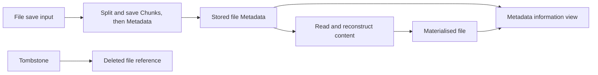

# Document and Chunk Type Contracts

## Status, purpose, and authority

This proposal separates database representations, content-processing stages,
and the information required by individual functions. It covers Commonlib,
DirectFileManipulator (DFM), and the Self-hosted LiveSync consumer. The
[companion ADR](../adr/2026_11_document_and_chunk_type_contracts.md) records the
architectural rationale and alternatives.

This design was accepted after implementation review. The local, unreleased
implementation adds information views, explicit Metadata and content reads,
DFM contracts, and raw shape checks. The oldest inline path-read correction
was approved separately during that review. Package publication and adoption
of its exact version remain separate steps. The type changes add no database
format or recovery-procedure change. The maintained
[data-structure reference](../datastructure.md),
[Chunk retrieval contract](chunk_retrieval_and_waiting.md), and
[revision-provenance contract](../specs_conflict_resolution.md) continue to
describe current behaviour.

The reviewed baseline is Self-hosted LiveSync `1.0.44`, revision
`03263a3888f44b17352f76b6181c08a487398b93`, consuming the locked Commonlib
`0.2.3` package. Commonlib source references below use its release revision
`dc1ee53cb2a6497684be4f2e2c5ed4573d65e857`.

The implementation review additionally examined Commonlib `0.3.0` at
`b5fd0b3866d7565b2da35f529ced3f61f4adbfeb`. The original baseline above is
retained. This later review does not imply that Self-hosted LiveSync has
adopted Commonlib `0.3.0`.

Commonlib owns shared document types, codecs, content reconstruction, and DFM.
Self-hosted LiveSync owns its feature-specific projections and callback
integration. Implementation belongs in those respective repositories, followed
by validation of the exact packed Commonlib artefact and its downstream
consumer. This proposal does not introduce a Commonlib source mirror here.

## Current relationships and their limits

The following relationships are established by the baseline
[document definitions][db-types] and [document unions][db-definitions].
Structural equivalence means mutual assignability; it does not mean that two
declarations have the same intended role or identical property declarations.

| Relationship | Current meaning | Proposed treatment |
| --- | --- | --- |
| `DatabaseEntry` | Document ID with optional revision, deletion, and conflict fields | Retain compatibility; distinguish an identified value from a revision-bearing read result. |
| `EntryBase`, `EntryHasPath`, and `EntryWithEden` | Independently composable field groups | Retain useful information views; keep Eden at the compatibility boundary. |
| `AnyEntry` and `EntryBody` | The same union of file entry variants | Use one canonical definition, retaining old names where compatibility requires them. |
| `InternalFileEntry` and `NewEntry` | Structurally equivalent; neither distinguishes all hidden files | Stop using the alias as proof of namespace or feature ownership. |
| `LoadedEntry` | `AnyEntry` intersected with content and `datatype` | Separate content results from the stored-document family. |
| `SavingEntry` | `AnyEntry` intersected with `data: Blob` | Replace the internal requirement with a dedicated save input. |
| `MetaEntry` | `AnyEntry` intersected with `children` | Distinguish a Metadata view from the exact stored representation. |
| `EntryDoc` | File entries, loaded entries, Chunks, and selected control documents | Use explicit document families at database and replication boundaries. |
| `EntryDocResponse` | `EntryDoc` plus PouchDB response information, including a required revision | Preserve the distinction between a body and a read response. |

`SavingEntry` inherits the legacy `NoteEntry.data` declaration as well as its
own Blob declaration. Its legacy branch therefore requires
`(string | string[]) & Blob`. The type also requires Chunk references before
the save operation has generated them.

`LoadedEntry` does not currently certify reconstruction. The
[Metadata reader][entry-impls] returns it with `data: ''`. The consumer also
casts incoming Metadata to that type before reconstructing content in
[ReplicateResultProcessor](../../src/serviceFeatures/replication/ReplicateResultProcessor.ts).
An empty string can also be valid file content, so its presence cannot
distinguish these cases.

`EntryDoc` is not an exhaustive union of every document in every store.
`SyncInfo` and `SyncParameters`, for example, are declared separately. A future
union must state its database or transport scope; including a document in a
type must not make it eligible for replication or file reflection.

### Implementation review findings

The oldest inline format is represented by `notes` or a missing `type`.
Direct legacy reconstruction retains its inline `data`, but the baseline path
Metadata reader projects it to `plain` with no children and placeholder
content. A subsequent path content read therefore returns empty content even
though the inline bytes remain in the database. A focused regression test
reproduces this discrepancy for both forms. The approved correction retains
the inline body and the legacy discriminator until reconstruction. It keeps
the existing path-based text and Base64 interpretation, and preserves the
requested revision. It does not rewrite the stored document or expand normal
replication admission to the oldest format.

DFM path and ID lookup also have different admission policies. Path lookup
excludes deleted entries by default and recognises the old inline forms; ID
lookup selects current Metadata and can return logical deletions. Sharing
Metadata types must not promise identical acceptance or failure behaviour.

Existing content-interpretation tests deliberately accept differing `type`
and `datatype` values, as well as path-based interpretation. Preserve those
compatibility views even if a new writer constructs correlated fields.

## Scope and preserved behaviour

The work changes type and function contracts while preserving these boundaries:

- Current file Metadata references separately stored Chunks. Normal saves
  persist the Chunks before publishing their Metadata.
- Existing document IDs, paths, discriminators, Chunk encodings, revisions,
  encryption, compression, and supported legacy inputs retain their meaning.
- Logical deletion and a PouchDB tombstone remain different representations.
- Missing content, unsupported input, malformed input, and failed operations
  retain their owning error and recovery policies.
- Current revision selection, conflict guards, document locks, provenance
  checks, and storage revalidation remain in their owning operations.
- This work adds no persistent state, database migration, Rebuild requirement,
  or new automatic repair or rejection policy.

Retiring old aliases does not authorise removing old readers. Tightening a
validator in a way which rejects an accepted input requires a separate
behavioural decision and compatibility evidence.

## Proposed model

### Information views and complete operation contracts

Use small interfaces for reusable information requirements. A function which
only resolves a path should not require a loaded file or a complete database
document. Use unions and composed types for alternatives and complete operation
inputs and results. Existing object type aliases do not need conversion merely
to standardise syntax.

| Design name | Information or guarantee | Does not establish |
| --- | --- | --- |
| `DocumentPathRef` | Document ID and logical path for path resolution | File content, revision availability, or path/ID agreement |
| `DeletionState` | Logical and database deletion markers | Authority to delete a file or revision |
| `FileProperties` | Creation time, modification time, and recorded byte size | Content equality, measured decoded size, or revision identity |
| `FileMetadataView` | The Metadata information required by a consumer | Absence of content or permission to persist the complete value |
| `FileContentView` | Content and the fields used to interpret its representation | Database persistence or current Vault agreement |
| `SplitSource` | Logical path and Blob content | A saved Metadata document |
| `FileToSave` | Target identity, path, file attributes, and Blob content | Existing Chunks, a chosen parent revision, or successful persistence |
| `RevisionRef` | One document ID and an explicit revision | A current, winning, readable, or Vault-matching revision |
| `MaterialisedFile` | A successful reconstruction result in the specified content representation | Local persistence, remote receipt, or continuing revision freshness |

These names describe proposed responsibilities. Exact required and optional
fields must follow the operation matrix below and the accepted compatibility
inputs, rather than treating this table as final declaration syntax.

### Relationships to retain and remove

Retain information sharing through interfaces for identity, paths, file
attributes, and deletion state. A materialised file can satisfy a Metadata
view when a consumer only needs those fields. Requiring Metadata does not
require content to be absent.

Keep current text and binary Metadata as discriminated alternatives. Keep
legacy file inputs explicit and separate from the types which new writers
produce. Hidden File Sync and Customisation Sync are namespaces and feature
ownership rules; they are not proved by the `InternalFileEntry` alias.

Save inputs and reconstruction results share useful information with stored
documents but are not stored-document variants. Remove the dependence on
`AnyEntry & { data: ... }` for their canonical internal definitions.

The arrows describe operations or use as an information view, not one class
inheritance hierarchy. Revision response information is an additional
requirement at the boundaries which need it.

### Stored and raw representations

Keep the following contracts distinct:

1. Raw transport or stored input before the applicable decoding transforms.
2. Decoded current file Metadata, legacy file inputs, Chunk documents, and
   applicable control documents.
3. Database tombstones and revision envelopes, which can lack an application
   body.
4. In-memory save inputs and materialised content.

A Metadata information view is not an exact serialisation schema. TypeScript
structural assignment permits extra fields. Writers must continue assembling
the persisted fields explicitly rather than spreading a content-bearing object
into the database. If the new stored-file types promise compile-time rejection
of `data`, encode and test that exclusion explicitly; a narrower interface
alone does not provide it. Legacy inline-content documents retain their
separate read contract.

Keep `DocumentID` and path tagging at the appropriate codecs. A check that a
property is a string does not establish its namespace, normalisation, or
agreement with another field. Distinct Chunk and file ID brands are a possible
follow-up, not a prerequisite for this proposal.

## Function and service contracts

| Function or boundary | Proposed input | Output or responsibility |
| --- | --- | --- |
| `getPath`, `getPathWithoutPrefix`, and corresponding path-service methods | Document ID and path view | Resolve the path using the existing prefix and obfuscation rules. Narrow the shared helper and service declarations together. |
| `isDeletedEntry` | Deletion-state view | Inspect flags without requiring content. |
| `isTextDocument` | Path and content-interpretation fields | Preserve current type, `datatype`, and legacy path-based interpretation. |
| `readAsBlob`, `readContent` | Content view with interpretation fields | Decode content without requiring document ID, times, or Chunk references. |
| `ContentSplitter.splitContent` and `getParamsFor` | `SplitSource` | Produce pieces or split parameters without requiring saved-document fields. |
| `getDBEntryMeta`, `fetchEntryMeta` | Existing target and revision/read options | Return Metadata without claiming content is loaded; an included tombstone produces an explicit deleted-file reference. |
| `getDBEntryFromMeta`, `fetchEntryFromMeta` | Supported Metadata or legacy content input | Return a successful content result only after the applicable reconstruction succeeds. Preserve waiting, local-only, and failure policies. |
| `putDBEntry` and its revision-specific variants | `FileToSave`, plus the existing explicit revision target | Generate Chunk references and persist Metadata in the established order. Do not require placeholder `children`, `eden`, or an independently supplied `datatype`. |
| `checkIsChangeRequiredForDatabaseProcessing` | Document path and revision information | Compare against current database revisions; do not require content. |
| `processOptionalSynchroniseResult` and Hidden File Sync receive handlers | File Metadata notification with applicable revision and deletion information | Select and queue feature-owned work; do not claim the notification carries reconstructed content. |
| `processSynchroniseResult` | Metadata notification sufficient for its handlers | Preserve re-reading of current state by the normal file handler. A deletion needs no fabricated content. |
| `processVirtualDocument` | The scoped received-document union and response information | Dispatch before normal-file selection; individual handlers can use smaller views. |
| `dbToStorage` | Target reference or path | Re-read current Metadata under the existing lock before reflection. |
| `dbToStorageWithSpecificRev` | Target and explicit revision | Revalidate and reflect the selected revision, retaining its distinct provenance contract. |

Do not narrow a public service declaration solely from one handler's field
reads. Check every maintained handler, wrapper, and package consumer before
changing that service contract.

The consumer's optional synchronisation callback currently receives `dbDoc`,
not the separately reconstructed `doc`. Hidden File Sync uses identity,
revision, and deletion information in
[CmdHiddenFileSync](../../src/features/HiddenFileSync/CmdHiddenFileSync.ts).
The normal Commonlib handler similarly uses the notification to request a
fresh read through [the file handler][file-handler]. This is why changing every
reflection callback to a loaded-content input would change the contract.

History restoration deliberately follows a different route: it stores the
chosen content as a new revision, then reflects that exact revision through
`dbToStorageWithSpecificRev`. Preserve that distinction in
[documentHistoryRestoration](../../src/serviceFeatures/documentHistoryRestoration.ts).

## DirectFileManipulator alignment

DFM's [current declarations and implementation][dfm] expose these differences:

| Surface | Baseline contract | Alignment |
| --- | --- | --- |
| DFM `MetaEntry` | Structurally equivalent to `NewEntry | PlainEntry` | Use the shared current-Metadata definition. |
| DFM `ReadyEntry` | Current Metadata plus `data: string[]`; no required `datatype` | Use a shared current content-result definition which retains the array guarantee. |
| Commonlib `LoadedEntry` | Includes legacy alternatives, `string | string[]`, and required `datatype` | Keep compatibility adaptation explicit; it is not a drop-in DFM alias. |
| `get(path, true)` | Metadata projected as `LoadedEntry` with placeholder content | Expose Metadata through the new contract. |
| `getById(id, true)` | Current Metadata | Align its semantic result with the path-based Metadata read, while preserving current acceptance and error behaviour. |
| Content reads, enumeration, and watch callbacks | Content results or broad unions independent of `metaOnly` | Tie result types to the read mode; keep Metadata selection callbacks separate from content callbacks. |

`ReadyEntry` is already assignable to DFM `MetaEntry`, so their union does not
guarantee content availability. Provide mode-specific overloads or equivalent
typed entry points, including a union for a Boolean mode not known until
runtime. Choose the exported form during package API design.

Shared result types do not unify failure policies. In the baseline,
`getByMeta` throws when content reconstruction cannot produce its required
result, while the underlying Commonlib reader can return `false`. Preserve
each method's established behaviour during type migration.

Keep DFM's existing public names through compatibility aliases or adapters
where their guarantees can be preserved. Do not widen `data: string[]` to
`string | string[]` merely to reuse a name. DFM `FileInfo` can share a file
attribute definition or projection; it does not need document identity or
deletion authority.

## Validation, guards, assertions, and construction

### Match the claimed type to the check

A predicate over a previously validated discriminated union can inspect only
its discriminator. A predicate accepting `unknown`, or merely an object with
an ID, cannot claim a complete Metadata or content type from that same check.

The baseline [utility guards][utils] illustrate the difference:

- `isLoadedEntry` checks a current note discriminator and the presence of
  `data`; it accepts Blob and numeric values as well as the Metadata placeholder.
- `isMetaEntry` checks only for `children`.
- The private `isEntryWithPath` in [document utilities][doc-utils] checks a
  string path but claims `MetaEntry`.
- Obfuscated-ID and encrypted-Chunk-ID checks identify an ID category, not the
  complete decoded body or successful decryption.

Use smaller predicate targets or complete boundary validation as appropriate.
Changing these claims does not by itself justify rejecting previously accepted
database inputs.

### Validation layers

| Layer | Contract | Appropriate result |
| --- | --- | --- |
| Shape inspection | Check the fields actually promised, including optional fields when present | A validated shape or structured reasons for failure |
| Classification | Select a family from an already validated union | A Boolean type predicate |
| Required precondition | Enforce a shape which the caller must supply | An assertion wrapper over the shared validator |
| Decoding and compatibility normalisation | Apply transforms or construct a supported internal representation | A returned value; an assertion cannot perform this conversion merely by narrowing |
| Content reconstruction | Read the named Chunks in order and handle unavailable content | An asynchronous content result with the existing failure policy |
| Live-state verification | Read database or storage state under the existing operation rules | The operation's verified outcome, subject to subsequent revalidation |

Illustrative assertion responsibilities are:

- `assertRevisionRef`: validate one identity and revision, without claiming
  that the revision is current or readable.
- `assertFetchedChunkPayload`: validate the accepted retrieval fields,
  without claiming a decoded stored `leaf` document.
- `assertDecodedCurrentFileMetadata`: validate the complete current Metadata
  shape promised after decoding and compatibility normalisation.
- A revision-import validator: validate identity and required ancestry for
  the import operation, without requiring ancestry metadata on every ordinary
  read.

Use one validation implementation for diagnostic results, Boolean guards, and
throwing assertion wrappers so that their acceptance rules do not drift.
Keep assertions at boundaries where an invalid value is an error. Ordinary
selection among supported document families uses classification instead.

### Compatibility and evidence limits

The [Chunk response classification test][chunk-response-test] explicitly accepts
responses containing an ID and data with absent or unexpected `type`. Its
current output is typed as `EntryLeaf[]`, although the validator establishes
fewer properties.
Represent the accepted retrieval payload honestly. Any conversion to a
canonical Chunk document at a write or notification boundary must preserve the
existing acceptance, response ordering, revision information, and claim
settlement behaviour. Decide that conversion explicitly before implementation;
do not substitute a strict stored-Chunk assertion at the retrieval boundary.

Metadata-only reads, valid empty content, and deleted-file references must be
distinct contracts. Do not use non-empty content or a positive child count as
a validation requirement. An assertion over string or array shape cannot prove
that reconstruction happened or that all required content was obtained.

The [Chunk fetcher][chunk-fetcher] emits fetched notifications even when its
database write fails. Its event name and structural validation therefore
cannot guarantee that a fetched value was persisted successfully.

Tombstones, compatibility `notes`, accepted type-less inputs, and embedded Eden
Chunks need their own paths before current-Metadata assertions are applied.
Preserve current decoding and path-based legacy interpretation. Do not require
new metadata fields or silently rewrite stored data during validation.

A valid shape, parsed revision, or matching ID does not prove current-leaf
membership, shared ancestry, content equality, Vault provenance, or freshness
after an `await`. Retain the authoritative checks and rechecks from the
[revision-provenance contract](../specs_conflict_resolution.md).

## Migration and verification

1. Agree final names, document-family scopes, and the public versus
   compatibility export surface. Inventory affected DFM and service consumers.
2. Add shared views, operation types, and boundary validators in Commonlib,
   with type-contract and behavioural compatibility tests before production
   changes. Keep legacy inputs represented explicitly.
3. Adapt Commonlib helpers, save and read boundaries, and DFM. Keep existing
   exports and failure policies through the agreed compatibility mechanism.
4. Validate the packed artefact and declarations, then update the exact
   Self-hosted LiveSync dependency. Narrow consumer helpers and callbacks
   together with their service declarations and fixtures.
5. Update Commonlib consumer documentation, this proposal's implementation
   note, the [data-structure reference](../datastructure.md), and the
   [documentation index](../README.md) when the implementation changes their
   recorded status. Retire aliases only under the agreed package policy.

For a defect correction, first run the smallest relevant regression test on
the unchanged implementation and confirm the expected failure. Establish the
passing baseline for accepted compatibility inputs before adapting them. A
new type-contract expectation is a proposed contract change until accepted;
its failure against the old declarations alone does not establish a runtime
defect.

Required verification includes:

- Type checks which permit content values as Metadata information views,
  reject Metadata as a complete content result, and keep revision-bearing
  reads distinct from first-write inputs.
- DFM mode-specific return types, its `string[]` guarantee, enumeration and
  watch contracts, and compatibility exports.
- Blob save inputs without fabricated saved-document fields; text and binary
  round trips; empty files; and Chunks-before-Metadata ordering.
- Malformed shape rejection at the intended boundary, alongside accepted
  legacy, type-less, Eden, and minimal Chunk retrieval inputs.
- Metadata reads with and without included deletions, body-less tombstones,
  and deletion reflection without loading unavailable content.
- Repeated and reordered Chunk references, missing Chunks, local-only reads,
  delivery waiting, and fetched notifications after a write failure.
- Current-state re-reading, exact-revision restoration, conflict and
  provenance preservation, and unchanged error/return conventions.

Commonlib owns shared model, validator, DFM, and reconstruction tests.
Self-hosted LiveSync owns its callback integration and host projections.
Run the required package and consumer checks for the actual implementation;
real Obsidian validation is needed when a change crosses its lifecycle,
storage, or visible integration boundary.

The original investigation used source and existing test inspection, temporary
TypeScript assignability queries, and small executions of installed guards.
Those observations established the design problem. Subsequent implementation
verification added the following evidence.

The four inline-read regressions first failed against the unchanged production
reader at the implementation baseline above. For both `notes` and a missing
`type`, path lookup returned empty content instead of the original text or
decoded bytes `[0, 255, 1]`; direct reconstruction retained the bytes. The same
cases pass after retaining the inline body in the Metadata projection.
Memory-PouchDB tests also exercise the public LiveSyncLocalDB, DFM, and
database-file-access methods with injected managers. They verify the selected
revision and bytes, empty content, the absence of a Chunk read for inline
content, and the unchanged stored body. They do not exercise host
initialisation or the Obsidian lifecycle.

The initial Commonlib implementation passed its full unit suite and package
boundary checks. The follow-up input migration passed the source type check,
the affected merge and integrity suites, and final packed consumer type/runtime
checks. The consumer checks use that packed artefact rather than a source
alias. Published package adoption and real Obsidian validation remain separate
from this local evidence.
Self-hosted LiveSync's source and application type checks, lint checks, Svelte
checks, production build, iOS 15 compatibility check, and unit tests have been
verified with the candidate. Its manifest and lock remain on the published
baseline until the new Commonlib artefact is available as an exact dependency.

## Implementation decisions and remaining work

The unreleased implementation uses the focused Commonlib `/documents` entry.
Small interfaces cover identity, path, deletion state, file attributes, content
interpretation, split input, and notifications. `FileToSave` supplies Blob
content before Chunk references exist; compatible optional caller fields remain
accepted. `CurrentFileDocument` excludes `data` and `datatype` statically, and
the writer still constructs persisted Metadata explicitly.

`FileMetadataResponse` carries the exact read revision. Current Metadata has
no content placeholder; compatibility `notes` retains its inline body.
`MaterialisedFile` contains ordered content parts and a required revision.
An included tombstone returns `DeletedFileRef` without fabricated file
attributes. New `getFileMetadata` and `getFile` methods coexist with the old
read methods. DFM exposes `getMetadata` and `getFile`, shares the current
Metadata/content definitions, and gives mode-specific ID and enumeration
results. Its old `get` contract remains available.

Replication callbacks use `FileChangeRef` or `FileMetadataNotification`.
Ordinary reflection still re-reads current state under its lock; exact-revision
restoration remains a separate operation. Consumer diagnostics use a Metadata
projection instead of claiming their placeholder is loaded content.

Raw Chunk, revision, and current-Metadata checks each provide inspection,
predicate, and assertion forms. Their results retain unbranded strings.
Current-Metadata inspection is opt-in and does not reject legacy inputs at
existing read boundaries. 'Current' denotes the file format; a complete body
with a database deletion marker can satisfy that shape, while a body-less
tombstone cannot. The reader separately returns a deleted-file reference.
Reads retain the typed database model and compatibility admission policies;
they do not establish that every stored field passed the raw inspectors.
In particular, accepted Eden content can lack the `epoch` required by complete
shape inspection. Strict rejection or normalisation remains separate work.
The Chunk classifier now promises only retrieval
fields. The existing `EntryLeaf` write/event interfaces retain an explicit
compatibility adapter, preserving payload identity, revisions, response order,
and notification-after-write-failure behaviour. No `leaf` field is injected.

Compatibility aliases and the broad `EntryDoc` union remain available.
Splitting every control/store union and migrating the complete Chunk
write/event hierarchy remain follow-ups; neither is required to correct the
contracts used here. Publication and an exact downstream dependency update
are required before these consumer changes can be merged independently.

## Follow-up audit of `LoadedEntry` inputs

The follow-up review traced field reads, mutations, forwarding, and maintained
callers. The local implementation now uses the input views below. Shared
views remain in Commonlib; repeated feature-specific requirements use local
interfaces without adding a package export for each function. Existing reads,
decoding, revision selection, waiting, and failure policies are retained.

| Input or value | Information actually used | Contract direction |
| --- | --- | --- |
| History `readDocument` | `path`, `type`, `datatype`, and `data` | Accept `FileContentView`; database identity and file attributes are unnecessary. |
| `EVENT_REQUEST_SHOW_HISTORY` payload | The handler uses only `fileOnDB._id`, alongside the separate file target | Accept `DocumentIdentity`; retain the event's existing payload layout. |
| Hidden File Sync `getComparingMTime` | Direct `mtime` and deletion markers, or `stat.mtime`, with false/null/undefined sentinels | Accept the timestamp shapes and sentinels rather than a file-document union. |
| Hidden File Sync `docToKey` and processing-cache helpers | `mtime`, `size`, optional `_rev`, and deletion markers | Share a feature-owned key view; content, Blob save inputs, and Metadata can satisfy it without claiming the same processing state. |
| Hidden File Sync `__writeFile` | Content interpretation plus `ctime` and `mtime` | Accept `FileContentView` composed with the required time fields. The caller still reconstructs content first. |
| JSON merge modal and pane | `data`, required `datatype`, `mtime`, identity, and optional revision | Use a comparison-content interface. It also supports consumer-constructed comparison values, so it must not require a database reconstruction brand or invent a revision. |
| Commonlib `tryAutoMergeSensibly` | Only `_rev`; the path is supplied separately | Accept `Pick<DatabaseEntry, '_rev'>`, retaining the existing optional-revision requirement. |
| Integrity checking's local decoding value | `path`, classification, and reconstructed `data` | Construct a `FileContentView` for `readAsBlob` instead of asserting a complete `LoadedEntry`. |

The JSON pane currently selects text or Base64 decoding from `datatype` alone.
Its comparison contract must keep that field required; adopting the optional
fields of `FileContentView` without qualification would admit values which
this decoder interprets differently. The Hidden File Sync merge wrapper also
uses the document path and forwards the comparison values to the modal.

The output and save review produced these boundaries:

- `extractInternalFileFromDatabase` forwards its source to reconstruction. It
  needs the complete supported Metadata or legacy content source, including
  Chunk references or inline data. A path, timestamp, or revision view is
  insufficient. Its input is the supported file union `AnyEntry`, which
  retains existing compatible content-bearing inputs.
- `loadBaseSaveData` combines content reads, Metadata reads, and a new-document
  default. Its overloads now distinguish a content-bearing save base from
  `FileMetadata`. A new save base has no required revision. Current Metadata
  mode strips `data` and `datatype`, while legacy Metadata retains its inline
  body. Logical deletion constructs `CurrentFileDocument` without content
  fields and retains the parent revision. Four focused regressions failed
  before this separation and pass afterwards; the existing legacy-body case
  remains covered alongside content-mode and new-document behaviour. A memory
  PouchDB test verifies that the deletion revision retains its parent ancestry
  and that the parent's original Base64 bytes remain readable.
- `createPluginDataExFileV2` reads content, time, and path, but also forwards
  document fields into its result. `CustomisationDocumentContent` now describes
  the input, while `CustomisationFileContent` describes the extracted bundle
  member used for comparison and application. The latter no longer inherits
  the complete database-document model. Existing field values and decoding
  remain unchanged.
- `createSavingEntryFromLoadedEntry` preserves caller fields in its published
  `SavingEntry` result. That compatibility adapter remains available with its
  complete input contract; a smaller input cannot support an unchanged promise
  of all saved-document fields. Hidden File Sync's ordinary save now uses
  `CompatibleFileToSave` directly.

These findings support structural information views for ordinary inputs.
They do not require phantom state parameters. Type fixtures cover minimal
cache, content-write, and comparison inputs, Metadata without content, and a
new save base without a guaranteed revision. Using fewer fields does not
establish that an upstream content read can be removed without changing
observable failure behaviour.

[db-types]: https://github.com/vrtmrz/livesync-commonlib/blob/dc1ee53cb2a6497684be4f2e2c5ed4573d65e857/src/common/models/db.type.ts
[db-definitions]: https://github.com/vrtmrz/livesync-commonlib/blob/dc1ee53cb2a6497684be4f2e2c5ed4573d65e857/src/common/models/db.definition.ts
[entry-impls]: https://github.com/vrtmrz/livesync-commonlib/blob/dc1ee53cb2a6497684be4f2e2c5ed4573d65e857/src/managers/EntryManager/EntryManagerImpls.ts
[file-handler]: https://github.com/vrtmrz/livesync-commonlib/blob/dc1ee53cb2a6497684be4f2e2c5ed4573d65e857/src/serviceModules/ServiceFileHandlerBase.ts
[dfm]: https://github.com/vrtmrz/livesync-commonlib/blob/dc1ee53cb2a6497684be4f2e2c5ed4573d65e857/src/API/DirectFileManipulatorV2.ts
[utils]: https://github.com/vrtmrz/livesync-commonlib/blob/dc1ee53cb2a6497684be4f2e2c5ed4573d65e857/src/common/utils.ts
[doc-utils]: https://github.com/vrtmrz/livesync-commonlib/blob/dc1ee53cb2a6497684be4f2e2c5ed4573d65e857/src/common/utils.doc.ts
[chunk-response-test]: https://github.com/vrtmrz/livesync-commonlib/blob/dc1ee53cb2a6497684be4f2e2c5ed4573d65e857/src/managers/chunkFetcher.helper.unit.spec.ts#L106
[chunk-fetcher]: https://github.com/vrtmrz/livesync-commonlib/blob/dc1ee53cb2a6497684be4f2e2c5ed4573d65e857/src/managers/ChunkFetcher.ts
