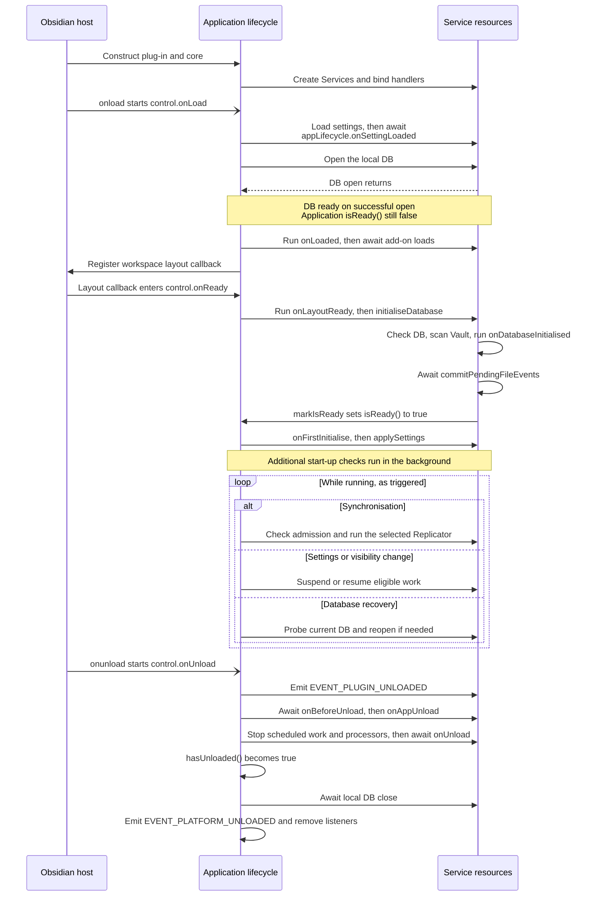
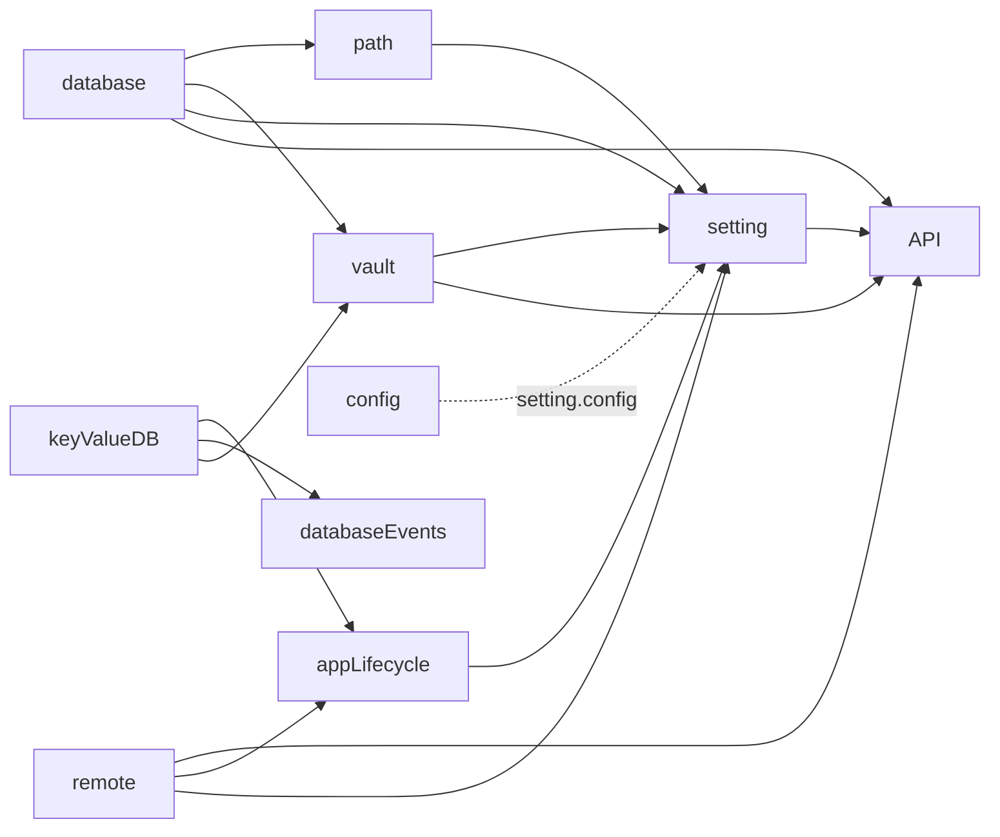
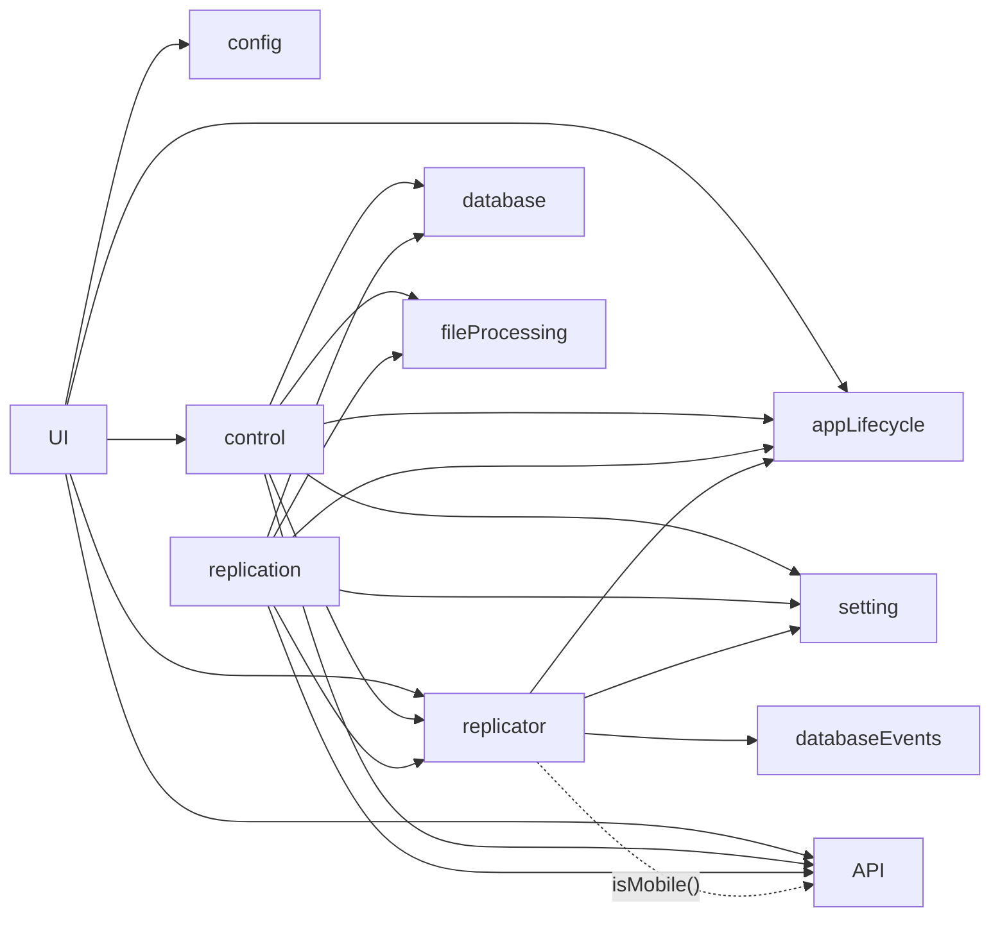
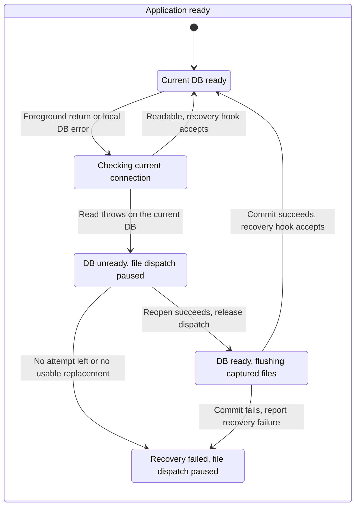
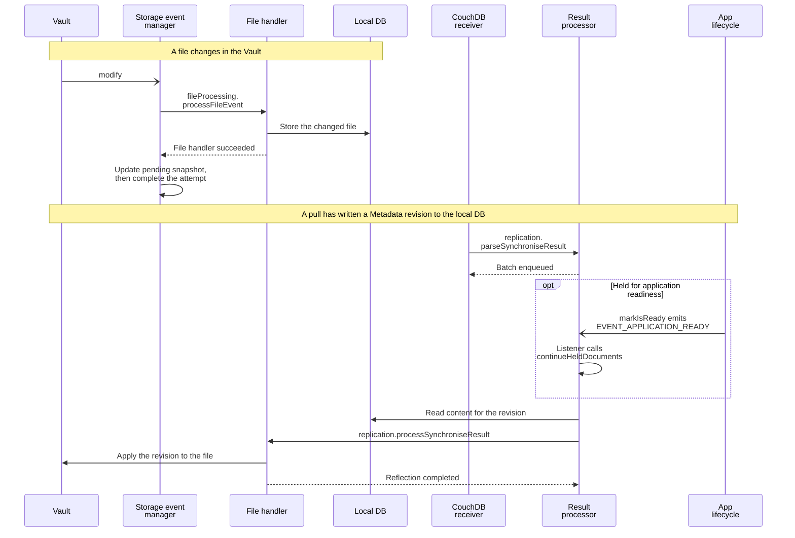

# Service Hub hooks through the plug-in lifecycle

When adding a serviceFeature, choose a hook by the resource your handler needs and the operation that must wait for it.

- Obsidian can request setting definitions inside `addSettingTab()`. The `appLifecycle.onSettingLoaded` handler seeds the tab with the saved settings before registering it, so those first definitions use the saved values. At this point the first local DB open is still ahead. [Settings tab decision](../adr/2026_08_declarative_settings_adapter.md) · [Tab registration](../../src/modules/features/ModuleObsidianSettingTab.ts#L11-L17)
- Obsidian enables file reflection recovery. Its `appLifecycle.onBeforeUnload` handler stops observing file changes, waits for pending document applications, and saves the remaining work to the key-value store. Control waits for this handler before the later `onUnload` phase closes the store. [Obsidian configuration](../../src/main.ts#L245) · [Unload binding](../../src/serviceFeatures/replication/index.ts#L185-L219) · [Result processor shutdown](../../src/serviceFeatures/replication/ReplicateResultProcessor.ts#L356-L365) · [Key-value store lifetime][kv]

This reference follows the Obsidian host in Self-hosted LiveSync 1.0.52 (`70899e2f`) and the Commonlib 0.7.0 package selected by its [lockfile](../../package-lock.json). Use the [Service dependencies](#obsidian-service-dependencies) to trace construction and the [service index](#service-index) to find a hook. For runtime paths, see [DB connection recovery](#db-connection-recovery-while-the-application-is-ready) and [Vault edits and incoming revisions](#vault-edits-and-incoming-revisions). [Other hosts](#other-hosts) identifies where the sequence differs.

## Lifecycle at a glance

Follow each column down the ordinary configured start-up path. The middle column tracks the application ready flag. The right column tracks resources that can become available earlier or be replaced later. The loop groups operations with independent triggers.

The two open arrowheads mark Obsidian callbacks that return `void` while the internal sequence continues. In particular, the log handler stays registered until the asynchronous shutdown settles. A hook can also launch work of its own. Its caller waits only for the promise the handler returns. [Obsidian entry points][host] · [Shutdown test][host-unload-test]

## Obsidian Service dependencies

Read each solid arrow **from a Service to a Service its constructor receives**. For example, `database` receives `path`, which in turn receives `setting`. Names repeated across the two views refer to the same instance. The dotted arrows show how the Hub exposes `setting.config` as `config` and passes `replicator` a callback for `API.isMobile()`. [Obsidian Service Hub][obsidian-hub]

### Storage, connections, and settings

### Replication, control, and UI

Every Service that the Hub constructs receives the shared `ObsidianServiceContext`. It also exposes the configuration store created by `setting` as `config`. Three Services have no incoming or outgoing constructor dependencies on other Services. These are `conflict`, `tweakValue`, and `test`. They receive only the context, and features access them through the Hub.

## Service index

The names below are accessors on `services`. A Service can own a resource, invoke a hook, or register a handler on another Service. Registration happens during composition. Invocation happens when a caller reaches the corresponding step. [Service Hub contract][hub] · [Obsidian Service Hub][obsidian-hub] · [Service and Module composition](service_feature_and_legacy_module_boundaries.md)

| Service | Where to look when choosing a hook |
|---|---|
| `control` | Drives [load and ready](#start-up), [settings application](#settings-and-suspension), and [shutdown](#shutdown). Its methods call handlers registered on other Services. |
| `appLifecycle` | [Start-up](#start-up), [suspension and resumption](#settings-and-suspension), and [plug-in shutdown](#shutdown). Owns the application ready flag. Diagnostic callers can also request `getUnresolvedMessages()`. |
| `setting` | [Settings load, save, and application](#settings-and-suspension). |
| `database` | Selects, opens, resets, recovers, and closes the [local database](#local-database-and-vault). |
| `databaseEvents` | Coordinates dependent owners during [physical DB transitions and application preparation](#local-database-and-vault). |
| `vault` | Owns the [Vault scan](#local-database-and-vault). Its target and ignore predicates are per-path queries. [Vault Service][vault] |
| `fileProcessing` | Dispatches [local file events](#file-events) and offers a finite completion boundary during preparation, settings changes, and synchronisation. |
| `replicator` | Owns [publication, suspension, and retirement of the active Replicator](#replicator-and-replication). |
| `replication` | Owns [run admission, incoming results, and finite completion](#replicator-and-replication). |
| `keyValueDB` | Ensures that the selected auxiliary store is open on the application settings-loaded and physical DB initialisation hooks. It reuses the open store when its key still matches. Reset and terminal unload have their own handlers. A namespaced handle can be constructed before the backing store opens. [Key-value DB Service][kv] |
| `config` | Provides scoped configuration values. Obsidian exposes `setting.config` here. [Obsidian Service Hub][obsidian-hub] |
| `API` | Supplies platform operations such as logging, Obsidian command registration through `addCommand()`, and host cleanup registration. [Obsidian API Service](../../src/modules/services/ObsidianAPIService.ts) |
| `UI` | Exposes the `UI.commands` registry, dialogues, and confirmations. The public accessor is `UI`. [Obsidian UI Service](../../src/modules/services/ObsidianUIService.ts) |
| `path` | Converts paths and document IDs for an operation. [Path Service][path] |
| `remote` | Opens connections and performs remote requests on demand. [Remote Service][remote] |
| `conflict` | Queues checks and selects a resolver for a file or revision. [Conflict resolution composition](service_feature_and_legacy_module_boundaries.md) |
| `tweakValue` | Checks and resolves setting mismatches with a remote during setup or synchronisation. [Module bindings](../../src/modules/coreFeatures/ModuleResolveMismatchedTweaks.ts) |
| `test` | Exposes `test()` and `testMultiDevice()` for registered development checks. The standard Obsidian composition omits `ModuleDev`. [Test Service][test-service] · [Obsidian composition](../../src/main.ts#L181-L190) |

## Start-up

The plug-in constructor creates the Hub. Core registers Replicator providers, creates ServiceModules and legacy Modules, composes features and add-ons, then binds legacy Module handlers. A feature can borrow a ServiceModule here and resolve its active DB later when its handler runs. [Composition root](../../src/LiveSyncBaseCore.ts) · [Feature order](../../src/serviceFeatures/coreFeatures.ts) · [Commonlib composition guide][composition]

In the table, ‘main load’ and ‘main ready’ refer to `ModuleLiveSyncMain._onLiveSyncLoad()` and `_onLiveSyncReady()`. Within a sequential hook, lower priorities run first and equal priorities follow registration order. Both `all` and `bailFirstFailure` stop the remaining handlers on `false` or an exception and return `false`. Whether the surrounding operation also stops depends on the caller. [Handler dispatch][dispatch] · [Start-up calls][startup] · [Control Service][control]

| Hook on `appLifecycle` | Who calls it and what the handler can use | What happens when it returns |
|---|---|---|
| `onLoad` | `control.onLoad()`, started by Obsidian `onload()`. The graph is bound. The main handler starts the worker module and loads settings and the DB. | Control awaits the chain. Only success registers the workspace layout callback. |
| `onWireUpEvents` | The main load handler installs listeners before reading settings. A listener can defer work until a later event. | Load awaits dispatch, then emits `EVENT_PLUGIN_LOADED` even if the hook returned `false`. |
| `onInitialise` | Main load calls early host setup after wiring. Saved settings and the selected DB are still ahead. | Main load awaits it and stops on `false`. |
| `onSettingLoaded` | Main load has awaited `setting.loadSettings()`. Use the current settings here, for example to register the settings tab or open the settings-selected key-value store. | Main load awaits the sequential handlers. A failure stops it before `database.openDatabase()`. Compare the [Setting Service hook of the same name](#settings-and-suspension). |
| `onLoaded` | Main load reaches this hook after the first DB open returns either `true` or `false`. If open throws, load stops before this hook. Check `database.isDatabaseReady()` before using the DB. Control resolves its `activated` promise from a handler here. | Main load awaits this hook, then uses `Promise.all` for add-on `onload()` calls even if the hook returned `false`. An add-on rejection can end load while other add-ons are still settling. |
| `onReady` | The workspace layout callback calls `control.onReady()`. In the standard Obsidian composition, `ModuleLiveSyncMain._onLiveSyncReady()` is the sole handler registered directly on this hook. It awaits `onLayoutReady` before requesting database preparation. | Control returns the chain's boolean. The workspace can deliver the callback after the plug-in has been disabled. See [disabling during start-up](#disabling-during-start-up). |
| `onLayoutReady` | The main ready handler calls this hook. Early handlers select a display language if none was saved, migrate any legacy P2P panes, and register workspace and window listeners. The start-up feature requests an onboarding invitation for an unconfigured Vault. In a configured Vault, a flag-file action can interrupt this path. [Language selection](../../src/serviceFeatures/onLayoutReady/enablei18n.ts#L54-L88) · [P2P panes](../../src/serviceFeatures/useP2PReplicatorUI.ts#L193-L215) · [Workspace listeners](../../src/modules/essentialObsidian/ModuleObsidianEvents.ts#L99-L117) | Main ready awaits the hook and stops on `false`. On success it emits `EVENT_LAYOUT_READY`. If file watching or processing incoming replication results is suspended, it asks whether to keep those settings or resume and restart. This happens before database preparation. |
| `onFirstInitialise` | Main ready has accepted the [database preparation result](#local-database-and-vault). On the ordinary path the application ready flag is already set. `ServiceFileAccessBase` awaits `vaultManager.beginWatch()`, which registers Obsidian Vault listeners for file creation, modification, deletion, and renaming. The start-up feature also runs its configured checks here. [Storage access binding][storage-access] · [Obsidian watch adapter](../../src/managers/ObsidianStorageEventManagerAdapter.ts#L94-L115) | Main ready awaits the chain. A refusal stops the path before `control.applySettings()`. This hook runs during core start-up. A DB reopen alone skips it. |
| `onScanningStartupIssues` | After `applySettings()`, main ready launches additional checks such as the conflict scan. | The background task awaits the hook and logs failure. Main ready can return while the checks are running. |

These phases describe one plug-in load. Disabling and enabling the plug-in creates a new composition. A DB reopen or a settings save can repeat narrower hooks on the same composition. [Configured start-up admission](../../src/serviceFeatures/startupLifecycle/startupLifecycle.ts) · [Load and ready tests](../../src/modules/main/ModuleLiveSyncMain.unit.spec.ts)

### Disabling during start-up

Disabling the plug-in can finish while `control.onLoad()` is still pending. If that call later succeeds, the old instance registers its workspace layout callback. A second ordering is possible at cold start. The instance registers the callback while the layout is pending, Obsidian disables the plug-in, and the workspace then delivers the queued callback. [Obsidian entry points][host] · [Control sequence][control]

In an unconfigured test Vault on Linux Obsidian 1.12.7, the disabled instance received `appLifecycle.onReady` and `appLifecycle.onLayoutReady` in both cases. At entry, `control.hasUnloaded()` was true and `database.isDatabaseReady()` was false. The P2P feature still looked for legacy panes, and `ModuleObsidianEvents` called the registration methods for `file-open` and `visibilitychange`. A handler that uses the local DB needs to check its current readiness. See [Shutdown](#shutdown) for the signal that shutdown has begun. [Main ready handler][startup] · [Database Service][database]

In both cases the priority-1 handler requested the onboarding invitation and returned `false` because the Vault was unconfigured. Main ready returned before emitting `EVENT_LAYOUT_READY`, preparing the DB, or starting the Vault file watcher. The invitation uses a delayed notice. When its timer ran, `ObsidianConfirm` saw that shutdown had aborted its dialogue controller and discarded the notice before display. [Start-up admission](../adr/2026_07_release_notes_and_database_compatibility.md#flag-file-recovery-order) · [Invitation](../../src/serviceFeatures/setupObsidian/setupManagerHandlers.ts#L17-L34) · [Notice timer](../../src/modules/services/ObsidianConfirm.ts#L183-L192)

## Local database and Vault

There are two useful boundaries for a handler. During physical open, `database` selects a `LiveSyncLocalDB` and that object creates a PouchDB handle and its managers. During application preparation, `prepareDatabaseForUse()` clears `appLifecycle.isReady()`, checks physical readiness, scans the Vault, and commits captured file work before setting application readiness. Ordinary Obsidian start-up uses the DB opened during load. An explicit initialisation can request a new open. [DB ownership and phases][db-guide] · [Physical DB][physical-db] · [Preparation and readiness][prepare]

| Hook | Caller, purpose, and state at entry | Completion and repetition |
|---|---|---|
| `database.onOpenDatabase` | `DatabaseService.openDatabaseUnlocked()` has selected and exposed a new wrapper. This is a point to prepare host state keyed by Vault name. Physical initialisation comes next. | The DB Service awaits the hook and proceeds even on `false`. Repeats for each new selection/open, including recovery replacement. |
| `databaseEvents.onDatabaseInitialisation` | `LiveSyncLocalDB.initializeDatabase()` has constructed PouchDB and the managers. Dependent owners can prepare before the managers initialise. | A handler returning `false` or throwing makes this hook return `false`. The initialiser rolls back and returns `false` to its caller. An underlying DB error can instead reject the open promise. Repeats on physical initialisation, including after reset. |
| `databaseEvents.onDatabaseHasReady` | The same physical initialiser has initialised managers, attached listeners, and provisionally set `LiveSyncLocalDB.isReady`. The selected DB can be used to initialise dependants such as the Replicator. | It awaits acceptance and checks the handle and ready flag again. A veto or lost handle rolls back the transition. A Vault scan can still be ahead. |
| `databaseEvents.initialiseDatabase` | Main ready requests wider preparation. `usePrepareDatabaseForUse` registers the handler. It clears application readiness, optionally opens the DB, and requires `database.isDatabaseReady()` before scanning. | The caller awaits the result. Handlers can return success, a permitted partial scan result, or failure. Any later handler can still veto. Also used by explicit preparation workflows. |
| `vault.scanVault` | Preparation asks the scanner to reconcile the selected files against the physically ready DB. Its options determine filtering, suspension handling, and whether individual file failures allow continuation. | Preparation awaits the scan. A failed scan stops it. A partial result continues only when requested, as on ordinary Obsidian start-up. Other callers can request a scan independently. |
| `databaseEvents.onDatabaseInitialised` | Preparation has accepted the scan result. The Replicator Service awaits `reinitialiseReplicator()`. The incoming replication feature starts restoring queued documents from its snapshot in the background. Its `EVENT_APPLICATION_READY` listener resumes processing documents held for readiness. [Replicator Service][replicator] · [Incoming replication handlers](../../src/serviceFeatures/replication/index.ts#L165-L171) | Preparation awaits the hook chain. The snapshot restore can still be running when the chain returns. A veto stops preparation. On success it awaits `fileProcessing.commitPendingFileEvents()` before calling `markIsReady()`. Repeats on wider preparation. |

`markIsReady()` sets the flag **before** emitting `EVENT_APPLICATION_READY` on the service context's event channel. Listeners see the new state. A second call while ready emits nothing. Clearing and re-establishing readiness emits again. If a later `initialiseDatabase` handler vetoes, main ready stops before `onFirstInitialise`. The veto does not undo the earlier ready flag or its event. On ordinary start-up, `onFirstInitialise`, settings application, and background checks still follow the event. Consumers that attach late can check the flag. [Application readiness tests][ready-tests] · [Preparation tests][prepare-tests] · [Start-up caller][startup]

### Reopen, recover, reset, or close

A physical connection can change while the application remains loaded and `appLifecycle.isReady()` is true. Resolve the current DB when an operation starts. The settings-selected name, active wrapper, and physical handle have distinct lifetimes. Obsidian's recovery feature coordinates a failed connection with file dispatch and replication. [Database Service][database] · [Obsidian recovery caller][recovery] · [Connection recovery design](local_database_connection_recovery.md)

| Hook | Caller, purpose, and state at entry | Completion and repetition |
|---|---|---|
| `database.onLocalDatabaseError` | Storage or replication code reports a local operation failure against the captured wrapper. The host checks that it still owns that connection before probing or attempting recovery. | Producers can notify asynchronously while the failed operation takes its own failure path. Handlers settle in order. A new failure can report again. |
| `databaseEvents.onBeforeDatabaseResume` | On an eligible hidden-to-visible transition, the Obsidian visibility handler requests a check of the current connection before flushing files or resuming replication. | Visibility handling awaits it. A refusal ends this transition before the flush. |
| `databaseEvents.onBeforeDatabaseRecovery` | `reopenDatabase()` has selected the failed current wrapper, cleared its physical ready flag, and retired its read waits. Dependent owners can settle work against that lifetime before close. | Reopen awaits acceptance and rechecks ownership before replacing anything. A refusal stops replacement. |
| `databaseEvents.onAfterDatabaseRecovery` | The host has either probed an already readable active connection or released its dispatch hold and committed captured file events. Retained work may retry against the current owner. | The host awaits acceptance before reporting success or taking the applicable resume path. This hook can run after a successful probe without any replacement. |
| `databaseEvents.onResetDatabase` | Physical reset has cleared DB readiness and requested active replication retirement. This is the preparation point before manager teardown and destruction. | Reset awaits the hook. A refusal prevents physical destruction. The DB Service then discards the active wrapper and attempts to close it. Earlier handlers may already have released state. |
| `database.onDatabaseReset` | The DB Service has successfully reset and reinitialised the physical DB. Dependants can rebuild state for that store. | The Service awaits acceptance. On failure it discards the failed active wrapper and the reset caller sees failure. |
| `databaseEvents.onCloseDatabase` | Explicit `LiveSyncLocalDB.close()` has cleared local readiness, stopped reads, and requested replication retirement. The physical handle is still present. | Close settles every handler sequentially and closes PouchDB even on an aggregate `false`. It then awaits manager teardown started by the physical `closed` event. Reset has a separate pre-destruction hook. |
| `databaseEvents.onUnloadDatabase` | The wrapper notifies dependants once per physical lifetime. `DatabaseService.closeDatabase()` calls the wrapper's synchronous `onunload()` before awaiting its `close()`. | `onunload()` starts the shared notification. `close()` awaits it before returning. Dispatch stops on the first failure and the boolean is ignored. For work requiring a still-open physical handle, use the explicit pre-close hook above. |

### DB connection recovery while the application is ready

The application stays ready throughout this recovery. The states below describe the **local connection and file dispatch** in a configured, active Obsidian host. A local operation can fail while the connection is still readable. Both that failure and a return to the foreground can trigger a probe of the current connection. [Recovery caller][recovery] · [Connection tests](../../src/serviceFeatures/databaseConnectionRecovery.unit.spec.ts)

- **Readable connection.** With no dispatch hold to release, the active host calls `onAfterDatabaseRecovery` on the existing connection. A probe that returns `false`, for example because close has begun, ends the check. A rejected read on the still-current connection starts replacement.
- **Replacement.** The host stops new read waits, pauses file dispatch, requests suspension and Replicator retirement, and waits for work already dispatched. File events can still be admitted while dispatch is paused. A background host defers reopening until it becomes active. The host allows one reopen attempt between foreground returns. If an explicit open wins the race, recovery checks the new owner before releasing the hold.
- **Return to service.** After reopening, the host releases file dispatch so the captured work can run. It awaits `commitPendingFileEvents()`, then `onAfterDatabaseRecovery`. A failed commit pauses dispatch again. A veto from the recovery hook reports failure after the flush. Replication resumes only on an eligible path while the host is active and the application allows it. [Recovery and resumption order][recovery] · [Dispatch and admission][storage-manager]

## File events

A watcher can accept a later change while earlier work is completing. The storage-event manager's `waitForIdle()` captures the operations and pending admissions visible when the call begins. A successful flush means that the captured work completed. A later change, even to the same file, can still be pending. [Storage events and reflection][storage-guide] · [Storage-event dispatch][storage-dispatch] · [Write and reflection paths](file_write_and_reflection_paths.md)

| Hook on `fileProcessing` | Caller and service state | Completion and repetition |
|---|---|---|
| `processFileEvent` | The manager dispatches an ordinary file operation under its per-path lock. A handler stores, deletes, or otherwise handles that event. | The manager waits for the first handler to return `true`. If none succeeds, the attempt fails. Runs per dispatched event. |
| `processOptionalFileEventWithResult` | For an internal file, the manager uses registered result-aware providers and supplies the operation's flush signal. This lets a provider finish deferred work when a flush needs it. | The manager awaits the first handled outcome. A veto fails the operation. Runs per applicable internal event. |
| `processOptionalFileEvent` | If the result-aware route has no registered handler, the manager uses this legacy notification for the internal path. | It awaits dispatch and discards the boolean. This acknowledges notification delivery only. |
| `commitPendingFileEvents` | The storage access ServiceModule waits for the manager to finish the captured batch, including work already started. A later call captures a new batch. | Preparation and settings application require success. After a failed commit, visibility handling logs and can continue, the file-open handler skips replication and conflict checks, and DB recovery pauses dispatch again before resumption. [Storage access binding][storage-access] · [Visibility and file-open callers][visibility] · [DB recovery][recovery] |

### Vault edits and incoming revisions

The two routes below can run independently. The first follows a selected ordinary file whose contents changed in the Vault. The second follows an incoming CouchDB Metadata revision through to a successful write of that file. [Obsidian watcher](../../src/managers/ObsidianStorageEventManagerAdapter.ts#L94-L114) · [File handler bindings][file-handler] · [CouchDB receiver][couch-rx]

The watcher reports an edit that has already happened. A caller that needs its local DB work to settle uses `commitPendingFileEvents()`. On the incoming route, the receiver waits for the batch handler. The processor schedules its ordinary queue snapshot separately. It can skip a duplicate queued revision or replace a queued change for the same document when both changes have the same deletion status. It awaits file application for the changes it takes through that step. Its `EVENT_APPLICATION_READY` listener wakes work held for readiness, and explicit suspension still applies. [Receive and ready bindings][replication-feature] · [Receive queue](../../src/serviceFeatures/replication/ReplicateResultProcessor.ts#L826-L856) · [Per-document application](../../src/serviceFeatures/replication/applyReplicatedDocument.ts)

After a reflection failure, a retained revision can be `waiting` for the local DB, for remote content, or for both. `onAfterDatabaseRecovery` and `onFiniteReplicationCompleted` trigger checks for their respective resources. Once all recorded resources have recovered, that revision is eligible for one automatic retry. A revision in `review` is available for manual retry. [Recovery bindings][replication-feature] · [Reflection states and retry limits](chunk_transport_failure_recovery.md#state-and-retry-limit)

## Replicator and replication

The `replicator` Service owns the active publication. Its default bindings request retirement on physical DB initialisation and plug-in unload, and reinitialisation on both physical DB readiness and wider DB initialisation. Applying settings can retain an unchanged publication. Suspension requests a transfer stop while retaining the publication. Retirement closes admission to that publication and drains its reservations before closing the instance. The `replication` Service uses the selected provider to decide whether an operation can run. [Replicator owner][replicator] · [Host registrations][replication-feature] · [Active Replicator state diagram](replicator_architecture.md#active-replicator-lifecycle-and-exact-replacement-fence)

| Hook or owner operation | Caller, purpose, and state at entry | Completion and repetition |
|---|---|---|
| `replicator.getNewReplicator.addHandler` | Registers a legacy factory. When a candidate is needed, the owner uses the selected provider's factory or invokes the legacy chain if no provider definition applies. | The owner awaits construction. Publication requires further initialisation and validation, and can occur before application readiness. |
| `replicator.onBeforeReplicatorPublication` | A new candidate has initialised its local replication state and is still private. Host handlers clear state associated with the previous publication. | The owner awaits acceptance, then checks freshness before publishing. A veto discards the candidate. Reusing the current publication skips this hook. |
| `replicator.onCloseActiveReplication()` | An owner command used during DB transitions and terminal unload. It closes admission, asks the provider to stop, drains work admitted against that publication, and closes the instance. | The owner serialises the transition with replacement. Lifecycle callers await it. Result application can request retirement asynchronously so it can release its own work. |
| `replication.onCheckReplicationReady` | The readiness evaluator has checked application readiness and asks for lightweight policy checks. Keep handlers idempotent because one operation can cross this entry point more than once. | The evaluator awaits approval. A refusal stops admission before the file flush or remote preparation. |
| `replication.onPrepareCentralRemoteReplication` | After local state, captured file work, and network checks, readiness asks for any preparation required by a central-remote provider. | Readiness awaits each handler in order. A refusal or failed preparation blocks dispatch. Providers that omit this requirement skip this step. |
| `replication.onBeforeReplicate` | General preparation runs feature checks such as optional file scans. A directional full upload calls the hook before its first attempt. A directional download and a compatibility retry skip it. The Rebuilder also calls it when reconciling after a fetch. | Each caller awaits the chain. The first result other than `true`, or a handler error, blocks that preparation step. The Rebuilder can call the hook without starting a transfer. [Directional transfer][replication] · [Rebuilder][rebuilder] |
| `replication.parseSynchroniseResult` | CouchDB dispatches incoming pull batches to the hook. Journal and P2P skip dispatch when `suspendParseReplicationResult` is set. The shared handler enqueues ordinary file revisions for processing. | The receivers await dispatch and ignore its boolean. Vault reflection can still be pending. An observer should return `true` for documents it ignores so later handlers run. [CouchDB receiver][couch-rx] · [Journal receiver][journal-rx] · [P2P receiver][p2p-rx] |
| `replication.processVirtualDocument` | The result processor checks an incoming change for virtual document handling before ordinary file routing. | It awaits the handlers. A handled change leaves this path. Otherwise normal filtering and processing continue. |
| `replication.processOptionalSynchroniseResult` | During per-document application the processor offers the entry to optional features, including Hidden File Sync, after reading the required content. | It awaits handling. Success completes this route. Otherwise ordinary file application continues. |
| `replication.processSynchroniseResult` | The processor asks the first applicable handler to reflect an entry against its target revision. A handler returning `undefined` leaves it to the next handler. | The application step awaits the result. Absence of a result fails the step. A completed reflection can acknowledge the target, and handler errors propagate to the processor. |
| `replication.onFileReflectionFailed` | An ordinary Obsidian start-up scan with recovery enabled reports a failed reflection target so the recovery owner can retain it. | The scan callback awaits registration. It ignores the boolean, but a rejection propagates and can interrupt preparation. Repeats per reported failure. |
| `replication.onFiniteReplicationCompleted` | CouchDB reports successful one-shot sync or pull, including the finite catch-up before continuous replication. Push-only, cancelled, and failed attempts skip it. | CouchDB waits for all observers to settle and ignores the boolean. The reflection retry handler schedules its work to run separately, allowing the finite producer to release its activity. |
| `replication.onReplicationFailed` | A typed finite run has returned a failed outcome and released its activity and publication reservation. Recovery can now act on that attempt. | The coordinator awaits dispatch and returns the original failed outcome, even if a handler refuses and stops the chain. Repeats for qualifying failures. |
| `replication.checkConnectionFailure` | After a directional full transfer fails and releases its reservation, the registered tweak-compatibility handler examines the failure. | The caller awaits the first applicable answer. Only `CHECKAGAIN` requests one retry, bound to the same publication. [Compatibility handler](../../src/modules/coreFeatures/ModuleResolveMismatchedTweaks.ts#L455) |

If a `parseSynchroniseResult` handler runs before the shared enqueue handler and returns `false` or throws, the batch never reaches the queue through that dispatch. Journal has already stored the missing Metadata revisions. It can still mark the Journal file as received and skip it on the next ordinary sync. [Dispatch rules][dispatch] · [Journal receipt][journal-receipt] · [Journal listing][journal-list]

When Journal or P2P skips dispatch during suspension, clearing `suspendParseReplicationResult` alone resumes only work already queued. Obsidian's Fast Setup reconciles the local DB and Vault in a separate scan after the fetch. [Settings save handler](../../src/serviceFeatures/replication/automaticTriggers.ts#L55-L66) · [Fast Setup scan](../../src/serviceFeatures/redFlag.simpleFetch.ts#L278-L294)

For the decision before transfer, follow the [ordered readiness checks][replication-ready] and [typed run coordinator][typed-run]. For the wait after receipt, follow the [CouchDB receiver][couch-rx], [result processor](../../src/serviceFeatures/replication/ReplicateResultProcessor.ts), and [per-document application](../../src/serviceFeatures/replication/applyReplicatedDocument.ts). The [Replication Service][replication] defines the dispatch rules for both boundaries.

## Settings and suspension

Loading, saving, and applying settings are separate operations. A save can occur before the application is ready or while it is running. For work that must finish **before the first local DB open**, use the sequential `appLifecycle.onSettingLoaded`. The similarly named hook on `setting` is a notification launched from inside `loadSettings()`. [Settings implementation][setting] · [Obsidian storage bindings](../../src/modules/services/ObsidianSettingService.ts) · [Start-up caller][startup]

| Hook on `setting` | Caller, purpose, and state at entry | Completion and repetition |
|---|---|---|
| `onSettingLoaded` | At the end of each successful load, the Setting Service supplies the prepared runtime settings to observers such as the settings UI. | Load launches the parallel handlers and continues without awaiting them. Their completion can overlap the application settings-loaded hook. |
| `onSettingChanged` | The same load path launches a second notification with the current settings immediately after invoking `setting.onSettingLoaded`. | Parallel and detached. In 0.7.0 only a successful settings load emits it. |
| `onBeforeSaveSettingData` | Save preparation supplies the proposed and previously persisted settings. Handlers can return patches, for example an updated tweak timestamp. | Save awaits parallel results and applies the returned patches in dispatch order. Error results are skipped. Runtime patches are committed after the writes succeed. |
| `onSettingSaved` | After a successful write and commit, Obsidian's handler emits `EVENT_SETTING_SAVED` on `services.context.events`. The main Module subscribes through `eventHub`, the same instance in this host. | Save returns without waiting for application or UI reload. The listener starts a separate task. If the physical DB is ready, that task awaits `control.applySettings()`. It then emits `EVENT_REQUEST_RELOAD_SETTING_TAB`, including when the DB check skipped application. An application error skips the reload request. [Event channel](../../src/modules/services/ObsidianServiceContext.ts#L45) · [Save listener](../../src/modules/main/ModuleLiveSyncMain.ts#L120-L136) · [Tab listener](../../src/modules/features/SettingDialogue/ObsidianLiveSyncSettingTab.ts#L436-L438) |

Changing configuration encryption uses the same prepare, write, and commit steps, including both save hooks. Obsidian's SyncGuard preferences have their own persistence path. When a preference changes, `setSyncGuardSetting()` writes it to `config` and emits `EVENT_SYNC_GUARD_PREFERENCES_CHANGED`. [Settings implementation][setting] · [SyncGuard preferences](../../src/modules/services/ObsidianSettingService.ts#L89-L99)

`control.applySettings()` is called during start-up and can run again after a save. It awaits the following hooks in order. A hook's `false` result can stop the remaining handlers **within that hook**. Control ignores those booleans, except that it requires success from the intervening file commit. [Control Service][control] · [Scheduling handlers](../../src/serviceFeatures/replicationScheduling.ts) · [Settings application tests][control-tests]

| Hook | Caller, purpose, and state at entry | Completion and repetition |
|---|---|---|
| `appLifecycle.onSuspending` | Control invokes this hook before applying settings. Registered handlers request transfer cancellation and disable scheduling. Visibility handling and DB recovery can also request this reversible stop. The hook itself leaves the explicit suspended flag alone. | The invoking path awaits dispatch. The active Replicator may be retained. P2P has a separately owned room session to release. |
| `setting.onBeforeRealiseSetting` | Control allows scheduling to prepare before refreshing the local DB's settings. | After dispatch it refreshes DB settings and awaits `commitPendingFileEvents()`. A failed commit throws before settings realisation or resumption. |
| `setting.onRealiseSetting` | The DB has received the new settings and the file commit succeeded. Owners can reconfigure optional features and retain or replace the Replicator. | After dispatch Control tests `isSuspended()`. An explicit suspension or unconfigured Vault ends this application path here. |
| `appLifecycle.onResuming` | Eligible settings application, foreground return, or DB recovery prepares features for transfer again. | These callers await dispatch before invoking `onResumed`. Individual handlers can start separate work. |
| `appLifecycle.onResumed` | Resume preparation has run on the ordinary Obsidian path. Owners can restore scheduling or request transfers according to the current settings. | The caller awaits the returned promises. An independently scheduled transfer can still be pending. Settings application then invokes `onSettingRealised`. |
| `setting.onSettingRealised` | Control has run the resume hooks for this application of settings. Filters and scheduling can refresh against the applied configuration. | Control awaits this final hook and returns. Visibility-only resumption has a separate entry point. |

On Obsidian, visibility changes and focus or blur schedule a debounced check. Ordinary handling requires a configured, ready application and a change in document visibility. The application can stay ready while transfer is paused. Returning to the foreground first awaits `onBeforeDatabaseResume`. A pending-file commit failure is logged here. Bounded work can defer suspension, and desktop background replication can keep an eligible channel active on hide. The visible LiveSync-mode path can deliberately suspend before resuming to refresh that channel. These transitions can repeat without another plug-in load. [Visibility policy][visibility] · [Visibility tests](../../src/modules/essentialObsidian/ModuleObsidianEvents.unit.spec.ts)

Three settings operations also dispatch to features during setup, configuration, or reconstruction. Their callers determine when the changed settings are saved. [Rebuilder][rebuilder] · [Obsidian settings actions](../../src/modules/features/SettingDialogue/PaneSyncSettings.ts)

| Hook on `setting` | Caller and purpose | Completion |
|---|---|---|
| `suspendAllSync` | Setup, recovery, and CLI start-up can ask the Rebuilder to disable automatic sync settings. Its handler also invokes `suspendExtraSync`. | These callers await dispatch. This operation changes sync settings independently of the application suspended flag. |
| `suspendExtraSync` | Rebuilder and setup operations ask optional features to suspend their own sync policies. | Callers await sequential dispatch. A failing handler skips the remaining handlers in this chain. |
| `enableOptionalFeature` | A settings action passes an operation such as `MERGE`, `FETCH`, or `OVERWRITE` to the optional feature handlers. | The action awaits dispatch and ignores the boolean. Repeats when explicitly requested. |

## Shutdown

Use `appLifecycle.onBeforeUnload` for work that must finish before Control cancels tasks, stops processors, and closes the local DB. Return the promise that represents your preparation. Each owner can start retiring its own resources in this phase. A handler that needs a particular DB must still account for partial start-up and prior DB closure. Use `appLifecycle.onUnload` to retire resources owned for the plug-in lifetime. For a resource tied to **each physical DB**, choose a [database hook](#reopen-recover-reset-or-close).

| Hook on `appLifecycle` | State when `control.onUnload()` invokes it | Who waits and what failure changes |
|---|---|---|
| `onBeforeUnload` | Control has emitted `EVENT_PLUGIN_UNLOADED`. Its task cancellation and terminal DB close are still ahead. The storage access handler asks the manager to stop accepting events, flush captured work, and save its final pending snapshot. | Control settles **every** preparation handler in order, even after a refusal or exception. A failed flush can leave operations in the snapshot. A rejected final snapshot fails preparation. Control logs failure, continues cleanup, and rejects after cleanup if preparation failed. |
| `onAppUnload` | Preparation has settled. Owners can act before Control cancels periodic and scheduled tasks and stops running processors. | Control awaits the parallel handler results. Individual errors are collected and Control proceeds to cancellation. |
| `onUnload` | Control has issued those stop calls. Owners retire the active Replicator, release host resources, and close the auxiliary key-value store here. Control has yet to request the terminal local DB close. | Control awaits sequential dispatch. A refusal or exception skips later handlers in **this** chain. Control still sets `hasUnloaded()` to true and awaits `database.closeDatabase()`. On completion it emits `EVENT_PLATFORM_UNLOADED` and removes listeners. |

`EVENT_PLUGIN_UNLOADED` tells subscribers that shutdown **has begun**. For example, the scheduling feature stops scheduling replication on receipt. Handlers that Control must wait for return their work from `onBeforeUnload`. After the terminal DB close resolves, Control emits `EVENT_PLATFORM_UNLOADED` and removes the event listeners. If close rejects, `hasUnloaded()` is already true and Control exits before emitting that event or removing the remaining listeners. Obsidian's own `onunload()` returns without a completion promise. An abrupt process exit can interrupt the internal sequence. [Scheduling listener](../../src/serviceFeatures/replicationScheduling.ts#L431-L433) · [Obsidian entry point][host] · [Control sequence][control] · [Storage manager][storage-manager] · [Shutdown ordering tests][control-tests]

## Other hosts

| Host | Where its sequence differs |
|---|---|
| CLI | Command start-up awaits `control.onLoad()`, temporarily suspends sync settings, and awaits `control.onReady()` directly. If ready returns `false` or throws, the CLI awaits unload and aborts that command. Its signal-triggered shutdown routine also awaits `control.onUnload()` before exiting. [CLI entry point](../../src/apps/cli/main.ts) |
| WebApp | `startCore()` checks the load result and awaits the ready call directly. It continues after the ready call resolves without testing its boolean. Manual file import has its own completion checks before publishing readiness. Shutdown awaits storage-event cleanup and then Control's unload in a `finally` block. [WebApp runtime](../../src/apps/webapp/WebAppRuntime.ts) |
| WebPeer | Its specialised runtime loads settings, checks local DB open, calls `markIsReady()`, emits `EVENT_LAYOUT_READY`, and awaits `appLifecycle.onResumed()` for P2P start-up. Its start and shutdown callers share the respective promises. This path establishes readiness without the Obsidian Vault scan. [WebPeer runtime](../../src/apps/webpeer/src/WebPeerRuntime.ts) · [Host ordering tests](../../test/apps/webpeer/WebPeerRuntime.unit.spec.ts) |

[host]: ../../src/main.ts#L249-L267
[host-unload-test]: ../../src/main.onunload.unit.spec.ts
[obsidian-hub]: ../../src/modules/services/ObsidianServiceHub.ts
[startup]: ../../src/modules/main/ModuleLiveSyncMain.ts
[recovery]: ../../src/serviceFeatures/databaseConnectionRecovery.ts
[visibility]: ../../src/modules/essentialObsidian/ModuleObsidianEvents.ts
[replication-feature]: ../../src/serviceFeatures/replication/index.ts
[hub]: https://github.com/vrtmrz/livesync-commonlib/blob/484c164450d61deb2e301582b60cb9b5f9fa977f/src/services/ServiceHub.ts
[composition]: https://github.com/vrtmrz/livesync-commonlib/blob/484c164450d61deb2e301582b60cb9b5f9fa977f/docs/service-feature-composition.md
[dispatch]: https://github.com/vrtmrz/livesync-commonlib/blob/484c164450d61deb2e301582b60cb9b5f9fa977f/src/services/lib/HandlerUtils.ts
[control]: https://github.com/vrtmrz/livesync-commonlib/blob/484c164450d61deb2e301582b60cb9b5f9fa977f/src/services/base/ControlService.ts
[kv]: https://github.com/vrtmrz/livesync-commonlib/blob/484c164450d61deb2e301582b60cb9b5f9fa977f/src/services/base/KeyValueDBService.ts
[path]: https://github.com/vrtmrz/livesync-commonlib/blob/484c164450d61deb2e301582b60cb9b5f9fa977f/src/services/base/PathService.ts
[remote]: https://github.com/vrtmrz/livesync-commonlib/blob/484c164450d61deb2e301582b60cb9b5f9fa977f/src/services/base/RemoteService.ts
[vault]: https://github.com/vrtmrz/livesync-commonlib/blob/484c164450d61deb2e301582b60cb9b5f9fa977f/src/services/base/VaultService.ts
[test-service]: https://github.com/vrtmrz/livesync-commonlib/blob/484c164450d61deb2e301582b60cb9b5f9fa977f/src/services/base/TestService.ts
[db-guide]: https://github.com/vrtmrz/livesync-commonlib/blob/484c164450d61deb2e301582b60cb9b5f9fa977f/docs/database-lifecycle.md
[database]: https://github.com/vrtmrz/livesync-commonlib/blob/484c164450d61deb2e301582b60cb9b5f9fa977f/src/services/base/DatabaseService.ts
[physical-db]: https://github.com/vrtmrz/livesync-commonlib/blob/484c164450d61deb2e301582b60cb9b5f9fa977f/src/pouchdb/LiveSyncLocalDB.ts
[prepare]: https://github.com/vrtmrz/livesync-commonlib/blob/484c164450d61deb2e301582b60cb9b5f9fa977f/src/serviceFeatures/prepareDatabaseForUse.ts
[ready-tests]: https://github.com/vrtmrz/livesync-commonlib/blob/484c164450d61deb2e301582b60cb9b5f9fa977f/src/services/base/AppLifecycleService.unit.spec.ts
[prepare-tests]: https://github.com/vrtmrz/livesync-commonlib/blob/484c164450d61deb2e301582b60cb9b5f9fa977f/src/serviceFeatures/prepareDatabaseForUse.unit.spec.ts
[storage-guide]: https://github.com/vrtmrz/livesync-commonlib/blob/484c164450d61deb2e301582b60cb9b5f9fa977f/docs/storage-events-and-reflection.md
[storage-dispatch]: https://github.com/vrtmrz/livesync-commonlib/blob/484c164450d61deb2e301582b60cb9b5f9fa977f/src/managers/StorageEventManager/processing.ts
[storage-access]: https://github.com/vrtmrz/livesync-commonlib/blob/484c164450d61deb2e301582b60cb9b5f9fa977f/src/serviceModules/ServiceFileAccessBase.ts
[storage-manager]: https://github.com/vrtmrz/livesync-commonlib/blob/484c164450d61deb2e301582b60cb9b5f9fa977f/src/managers/StorageEventManager.ts
[file-handler]: https://github.com/vrtmrz/livesync-commonlib/blob/484c164450d61deb2e301582b60cb9b5f9fa977f/src/serviceModules/ServiceFileHandlerBase.ts
[replicator]: https://github.com/vrtmrz/livesync-commonlib/blob/484c164450d61deb2e301582b60cb9b5f9fa977f/src/services/base/ReplicatorService.ts
[replication]: https://github.com/vrtmrz/livesync-commonlib/blob/484c164450d61deb2e301582b60cb9b5f9fa977f/src/services/base/ReplicationService.ts
[replication-ready]: https://github.com/vrtmrz/livesync-commonlib/blob/484c164450d61deb2e301582b60cb9b5f9fa977f/src/services/base/ReplicationService.readiness.ts
[typed-run]: https://github.com/vrtmrz/livesync-commonlib/blob/484c164450d61deb2e301582b60cb9b5f9fa977f/src/services/base/ReplicationService.typedReplication.ts
[couch-rx]: https://github.com/vrtmrz/livesync-commonlib/blob/484c164450d61deb2e301582b60cb9b5f9fa977f/src/replication/couchdb/LiveSyncReplicator.ts
[journal-rx]: https://github.com/vrtmrz/livesync-commonlib/blob/484c164450d61deb2e301582b60cb9b5f9fa977f/src/replication/journal/JournalSyncCore.ts#L819-L824
[journal-receipt]: https://github.com/vrtmrz/livesync-commonlib/blob/484c164450d61deb2e301582b60cb9b5f9fa977f/src/replication/journal/JournalSyncCore.ts#L944-L962
[journal-list]: https://github.com/vrtmrz/livesync-commonlib/blob/484c164450d61deb2e301582b60cb9b5f9fa977f/src/replication/journal/JournalSyncCore.ts#L758-L765
[p2p-rx]: https://github.com/vrtmrz/livesync-commonlib/blob/484c164450d61deb2e301582b60cb9b5f9fa977f/src/replication/trystero/P2PRoomSessionOwner.ts#L593-L605
[setting]: https://github.com/vrtmrz/livesync-commonlib/blob/484c164450d61deb2e301582b60cb9b5f9fa977f/src/services/base/SettingService.ts
[rebuilder]: https://github.com/vrtmrz/livesync-commonlib/blob/484c164450d61deb2e301582b60cb9b5f9fa977f/src/serviceModules/Rebuilder.ts
[control-tests]: https://github.com/vrtmrz/livesync-commonlib/blob/484c164450d61deb2e301582b60cb9b5f9fa977f/src/services/base/ControlService.unit.spec.ts
