# クイックセットアップ

[英語版](./quick_setup.md) - [中国語版](./quick_setup_cn.md)

このガイドでは、最初のデバイスで通常のノート同期を開始し、その後、別のデバイスを追加します。オプション機能は、この基本的な同期が動作することを確認してから設定してください。

開始前に、次の準備をしてください。

- 対象となるすべての Vault をバックアップする。
- Obsidian Sync、iCloud 同期、および同じ Vault に書き込む他のサービスを無効にする。
- リモートサービスとセットアップ URI を用意する。
- セットアップ URI とそのパスフレーズを別々に保管する。

この手順では、推奨されるプロビジョニング済み CouchDB の手順を説明します。サーバーとセットアップ URI の準備方法は[こちら](./setup_own_server_ja.md)を参照してください。

## セットアップ URI の内容

セットアップ URI は `obsidian://setuplivesync?settings=` で始まります。認証情報を含む接続設定が暗号化されて格納されていますが、暗号化されていても URI 自体を安全に保管してください。

セットアップ URI 用のパスフレーズは URI を復号するためのものです。同期データを保護する Vault 暗号化パスフレーズとは別のものです。両方を安全に保管し、URI とそのパスフレーズを同じ経路で送らないでください。

## 1台目のデバイスをセットアップする

リモートデータベースが新規の場合、またはサーバー全体を再構築する際にこのデバイスを明示的に正本とする場合に限り、この手順を使ってください。

1. 対象の Vault に Self-hosted LiveSync をインストールして有効にします。
2. `Welcome to Self-hosted LiveSync` 通知を選び、オンボーディングを開きます。
3. `I am setting this up for the first time` を選び、新しい同期をセットアップすることを確認します。
4. `Connection Method` で `Use a Setup URI (Recommended)` を選びます。
5. セットアップ URI を貼り付け、URI 用のパスフレーズを入力して `Test Settings and Continue` を選びます。

   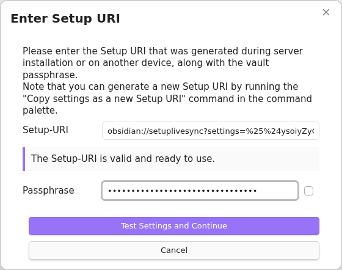

6. `Setup Complete: Preparing to Initialise Server` の内容を確認し、`Restart and Initialise Server` を選びます。

   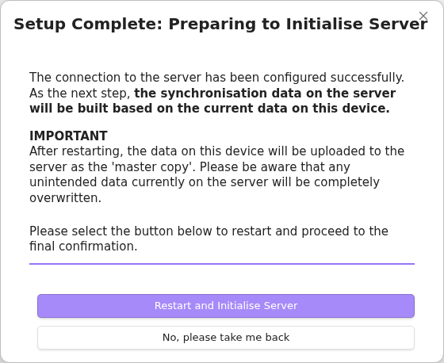

7. 最終的な上書き警告をよく読みます。バックアップがあり、リモートデータを置き換える意図があることを確認してから、`I Understand, Overwrite Server` を選びます。

   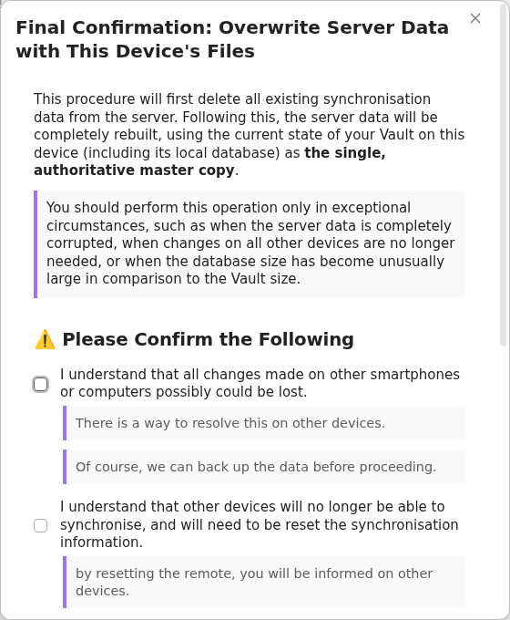

8. 新規に用意したデータベースでは、`No Synchronisation Settings Found` と表示される場合があります。新しいデータベースであることが確かな場合は、`Use this device's settings` を選びます。既存の設定があるはずなら、キャンセルして接続先のリモートを確認してください。キャンセルすると、Vault とデータベースへの反映を一時停止した状態で再起動します。リモートを確認するまで LiveSync を無効のままにしてください。`Could Not Read Synchronisation Settings` と表示された場合は再試行するか、このデバイスの設定を使って上書きを続行します。上書きには正常な接続が必要です。

   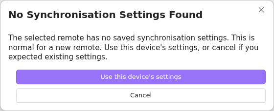

9. `All optional features are disabled` の確認に進みます。通常の同期経路を確認するまで、オプション機能は無効のままにしてください。
10. 初期化と、要求された再起動が完了するまで待ちます。LiveSync の進捗表示が消えるまで Obsidian を開いたままにしてください。

別のデバイスを追加する前に、通常のテストノートを作成し、アップロードが完了するまで待ちます。

## 別のデバイス用のセットアップ URI を作成する

動作中の1台目のデバイスで、追加デバイス用のセットアップ URI を作成します。サーバーのプロビジョニング時に作成した URI を使い回すのではなく、1台目で実際に使われている設定を取り込めます。

1. 1台目で Obsidian のコマンドパレットを開きます。
2. `Self-hosted LiveSync: Copy settings as a new Setup URI` を実行します。
3. URI を保護する新しいパスフレーズを入力し、`OK` を選びます。

   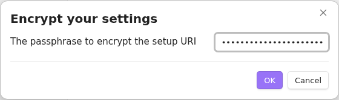

4. 生成されたセットアップ URI をコピーし、`OK` を選びます。

   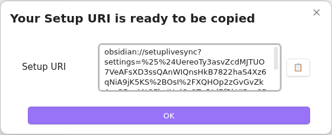

新しい URI とそのパスフレーズは別々に保管してください。URI は暗号化されていますが、認証情報と Vault 設定を含むため、引き続き安全に扱ってください。

## 別のデバイスを追加する

新しい Vault、または別途バックアップした Vault を使ってください。未同期のノートがある本番 Vault は、[Fast Setup の選択肢](./tips/fast-setup_ja.md)を確認せずに使用しないでください。

1. Self-hosted LiveSync をインストールして有効にします。
2. `Welcome to Self-hosted LiveSync` 通知からオンボーディングを開きます。
3. `I am adding a device to an existing synchronisation setup` を選び、デバイスを追加することを確認します。
4. `Device Setup Method` で `Use a Setup URI (Recommended)` を選びます。
5. 1台目で作成した新しいセットアップ URI を貼り付け、URI 用のパスフレーズを入力して `Test Settings and Continue` を選びます。
6. `Setup Complete: Preparing to Fetch Synchronisation Data` の内容を確認し、`Restart and Fetch Data` を選びます。

   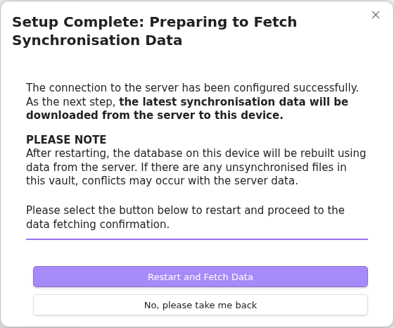

7. 新規または空の Vault では `Overwrite all with remote files` を選びます。ローカルの作業がある Vault では操作を止め、[Fast Setup ガイド](./tips/fast-setup_ja.md)から適切な方法を選んでください。

   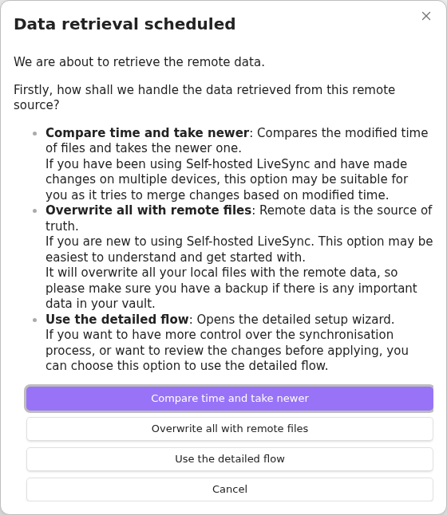

8. 追加のローカルファイルの扱いを尋ねられたら、保守的な選択肢は `Keep local files even if not on remote` です。ローカル Vault を破棄してリモートと完全に同じ状態にする意図がある場合に限り、削除する選択肢を使ってください。

   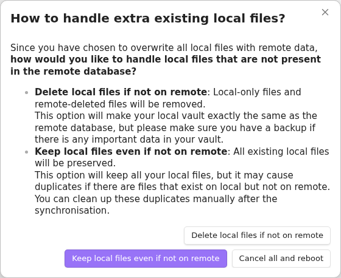

9. データ取得、ファイルへの反映、および要求された再起動が完了するまで待ちます。LiveSync の進捗表示が消えるまで Obsidian を開いたままにしてください。

1台目で作成したテストノートが変更されずに表示されることを確認します。次に、新しいデバイスで2つ目の通常ノートを作成または編集し、1台目に届くことを確認します。

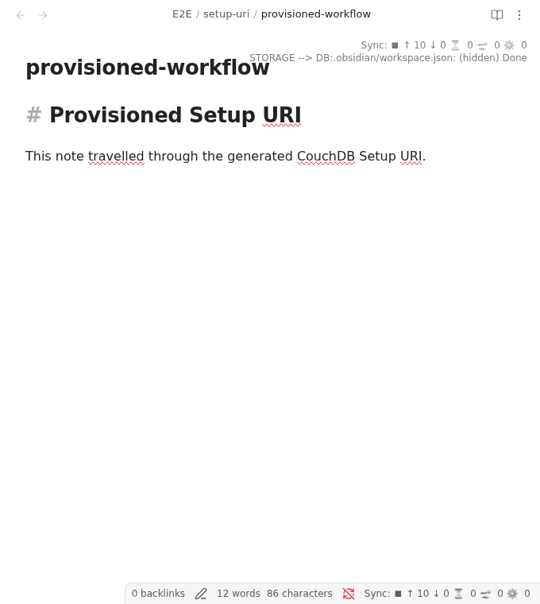

## 通常の同期が動作した後

オプション機能は、どの機能が管理するかと初期化の方向を明確にするため、1つずつ追加してください。

- 選択した非表示ファイルやフォルダーには[非表示ファイル同期](./tips/hidden-file-sync.md)を使用します。
- Obsidian のカスタマイズ設定には[カスタマイズ同期](./settings_ja.md#6-customisation-sync-advanced)を使用します。

同じファイルに両方の機能を有効にしないでください。

## 1台目で CouchDB を手動設定する

この方法は CouchDB の準備ができていて、セットアップ URI を利用できない場合に使います。表示されるオンボーディング画面で1台目を設定する手順であり、CouchDB サーバーのプロビジョニングや修復は行いません。後続のデバイスには、認証情報を再入力するのではなく、この1台目で動作確認後に作成したセットアップ URI を使ってください。

1. 対象の Vault に Self-hosted LiveSync をインストールして有効にします。
2. `Welcome to Self-hosted LiveSync` 通知を選び、`I am setting this up for the first time` を選択して、新しい同期をセットアップすることを確認します。
3. `Connection Method` で `Configure a remote manually`、続けて `Proceed with manual configuration` を選びます。

   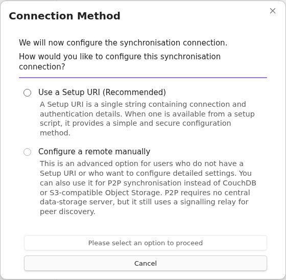

4. `End-to-End Encryption` で同期データの保護方法を決めます。
   - 通常の新規 Vault では `End-to-End Encryption` を有効にし、強力な Vault 暗号化パスフレーズを入力します。
   - リモートドキュメントのプロパティも隠す場合は `Obfuscate Properties` を有効にします。
   - Vault 暗号化パスフレーズは安全に保管してください。セットアップ URI を保護するパスフレーズとは別のものです。

   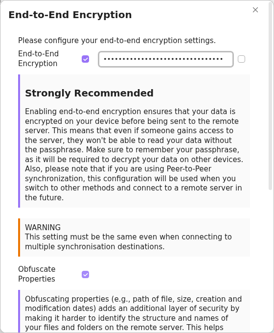

5. `Choose a synchronisation remote` で `CouchDB` を選び、`Continue to CouchDB setup` を選びます。

   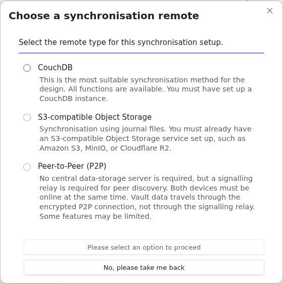

6. CouchDB の完全な URL、ユーザー名、パスワード、データベース名を入力します。
   - Obsidian Mobile では HTTPS が必要です。HTTP は、デスクトップから信頼できるローカル接続を行う場合に限り使用できます。
   - 選択したデータベースへの接続が許可された認証情報を使います。1台目を設定する際、データベースが存在しなければ作成できる権限も必要です。

   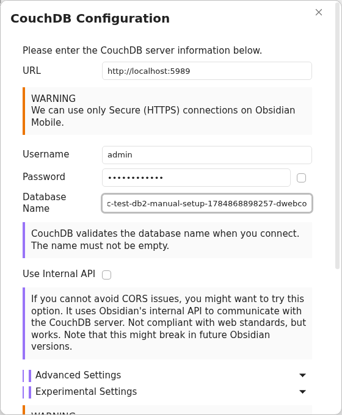

7. `Check server requirements` は任意です。表示中の認証情報を Obsidian の内部リクエスト API 経由で設定済みサーバーへ送信します。一部の検査には CouchDB 管理者権限が必要です。最初の検査は読み取り専用です。サーバー変更が提案された場合は、個々の変更内容を確認してから別途承認してください。

   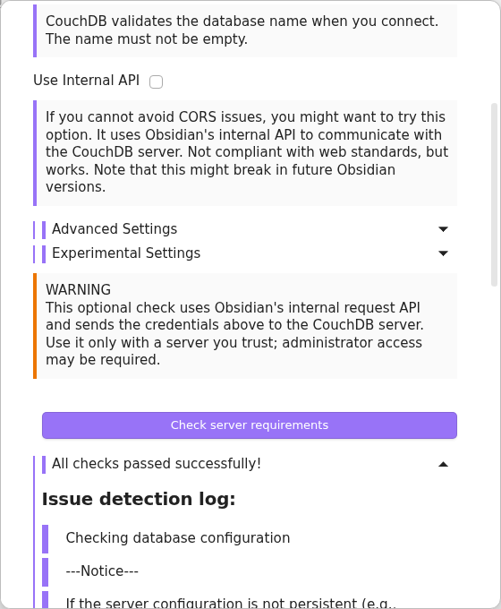

8. `Create or connect to database and continue` を選びます。オンボーディングを続けるには、この接続テストに成功する必要があります。
9. `Setup Complete: Preparing to Initialise Server` の内容を確認し、`Restart and Initialise Server` を選びます。
10. 最終的な上書き警告を読みます。このデバイスを正本とする意図があり、最新のバックアップがある場合に限り、`I Understand, Overwrite Server` を選びます。
11. 新規作成したデータベースでは `No Synchronisation Settings Found` と表示される場合があります。この新規データベースであることが確かな場合は、`Use this device's settings` を選びます。既存の設定があるはずなら、キャンセルして接続先を確認してください。キャンセル後は Vault とデータベースへの反映を一時停止した状態で再起動するため、リモートを確認するまで LiveSync を無効のままにしてください。`Could Not Read Synchronisation Settings` と表示された場合は再試行するか、このデバイスの設定を使って上書きを続行します。上書きには正常な接続が必要です。
12. `All optional features are disabled` の確認に進み、初期化の進捗が消えるまで Obsidian を開いたままにしてください。

通常のテストノートを作成し、同期されることを確認します。CouchDB に届いたら、[別のデバイス用のセットアップ URI を作成する](#別のデバイス用のセットアップ-uri-を作成する)、続けて[別のデバイスを追加する](#別のデバイスを追加する)に進んでください。これにより、2台目の設定を、1台目で実際に適用されたリモートプロファイルと暗号化設定に合わせられます。
