# IBM Cloudant のセットアップ

## インスタンスの作成
下記の手順で、試用のために IBM Cloudant のインスタンスを作成できます。

1. 「リソースの作成」ボタンをクリックします。  
   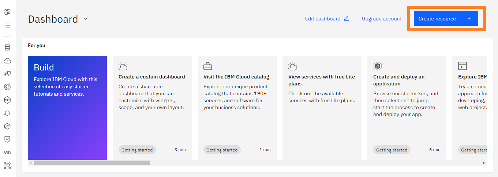

1. カタログが開くので、「Cloudant」と検索してください。出てきた選択肢をクリックすると作成画面に進みます。  
   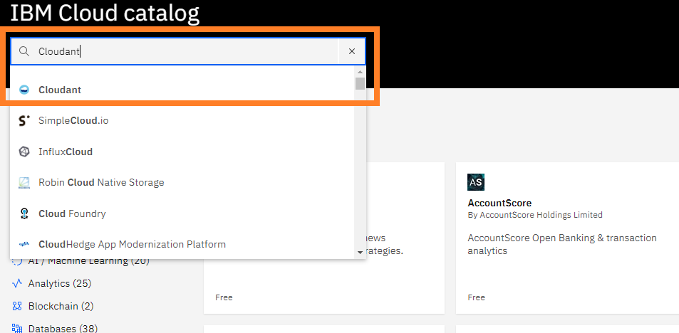

1. 無料の Lite プランを選択してください。  
   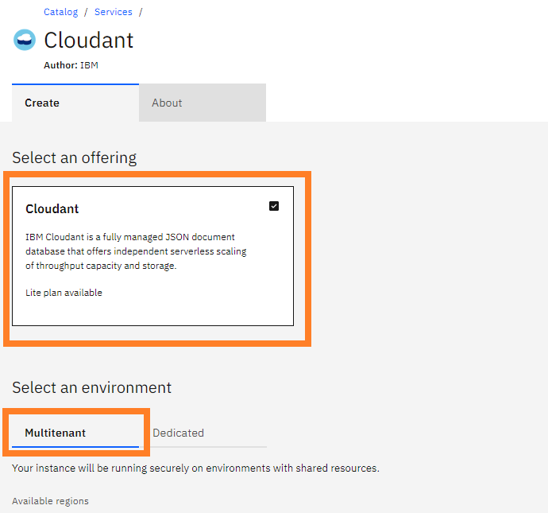

1. リージョンと環境を選択します。Lite では Multitenant しか選択できないので、Multitenant を選択してください。デフォルトで選択されています。  
リージョンはお好みの場所で作成してください。
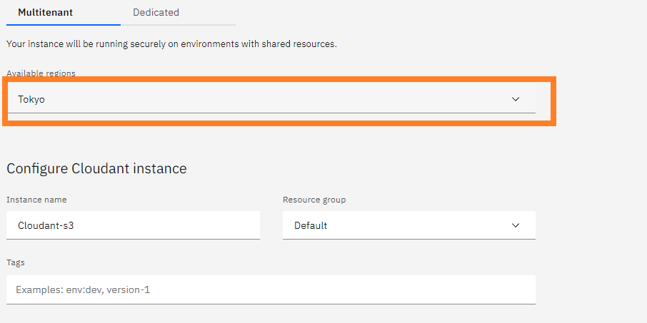 

1. "Authentication Method"で「IAM and legacy credentials」を選択します。  
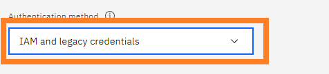

1. Lite プランが選択されていることと、Capacity を確認します。  
   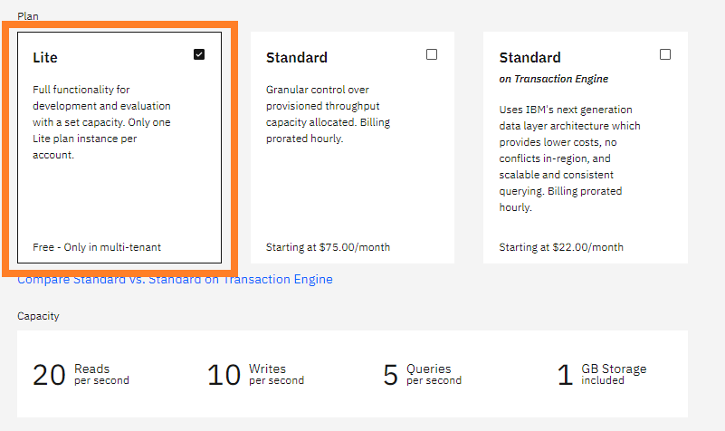

1. 確認ができたら、右側の Create ボタンをクリックします。  
   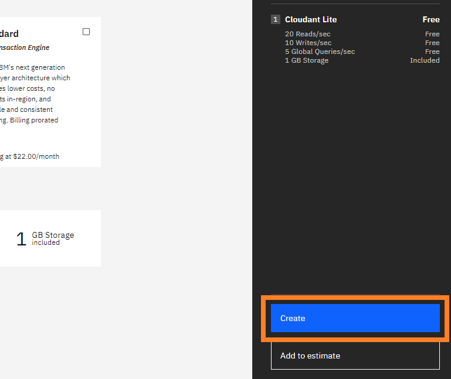

1. 上記の手順が正常に完了したら、左のメニューから「リソース・リスト」をクリックしてください。リソース・リストが表示され、「サービスおよびソフトウェア」に作成した Cloudant のインスタンスが表示されます。
インスタンス名をクリックしてください。  
   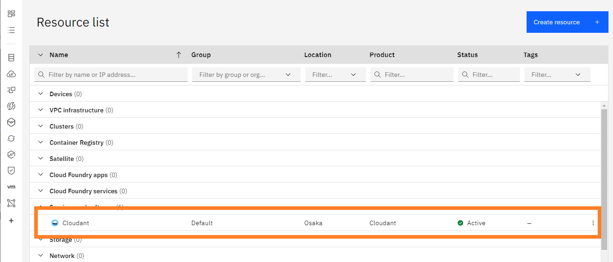

1. ここで、"External Endpoint (preferred)" と記載されているアドレスを控えてください。後ほどデータベース名と組み合わせて使用します。(\*1)  
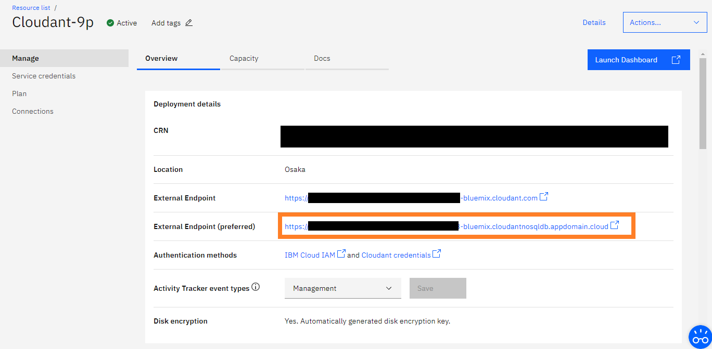

## データベースの設定

1. 「Launch Dashboard」ボタンをクリックします。すると、データベースのダッシュボードが表示されます。これは CouchDB の Fauxton インターフェースとほぼ同じものです。  
    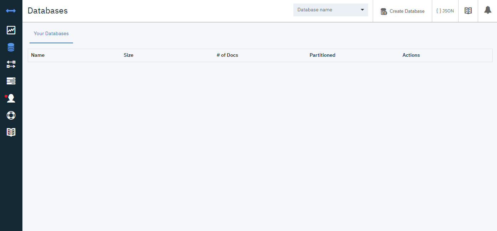

1.  CORS の許可設定を行います。メニューの「Account」をクリックし、「CORS」タブを開きます。  
最初は「Restrict to specific domains」が選択されているので、「All domains (\*)」を選択し直します。この反映は即座に行われますが、すぐに戻せるので大丈夫です。  
ただし、Cloudant では `app://obsidian.md` を許可する設定は使用できません。  
    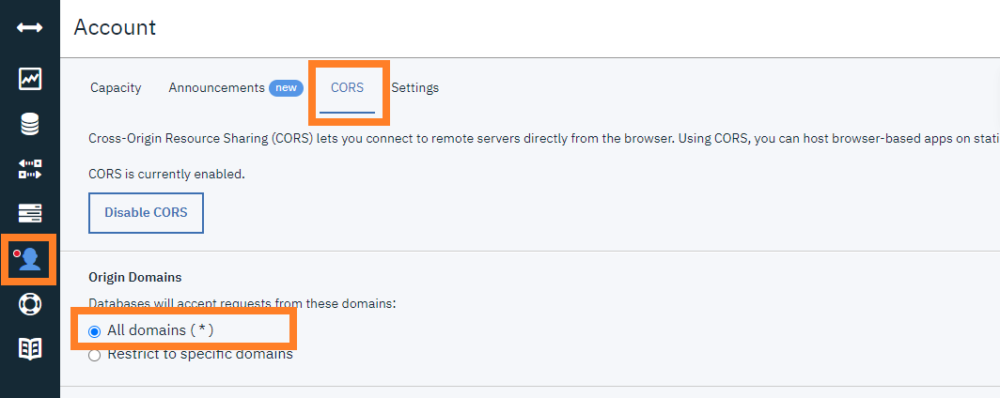

1. データベースが作成できるか確認します。メニューの「Databases」をクリックし、次に「Create Database」ボタンをクリックします。  
右側にパネルが表示されますので、好きな名前を入力し(\*2)、「Create」ボタンをクリックします。  
    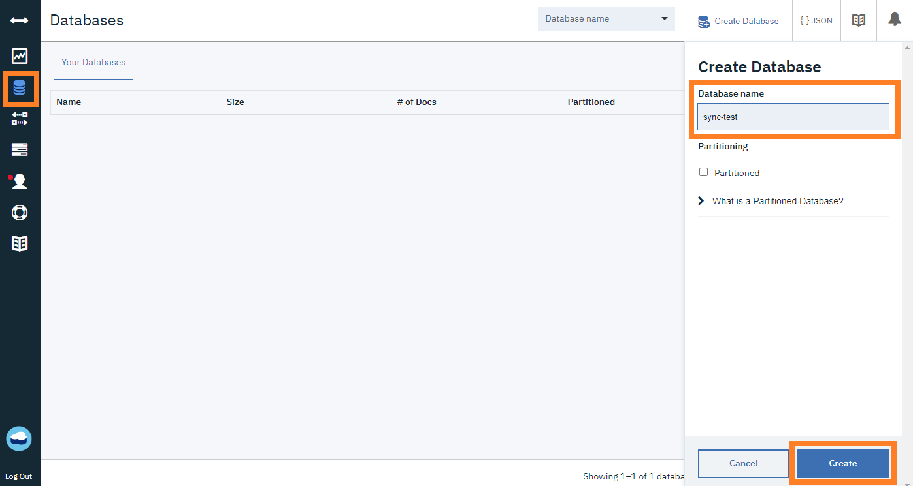

1.  完了を示すメッセージが表示された後、データベースが表示されていれば、セットアップはほぼ完了です。データベースを作成できることを確認した後は、通常この画面を開く必要はありません。Self-hosted LiveSync からもデータベースを作成できます。  
    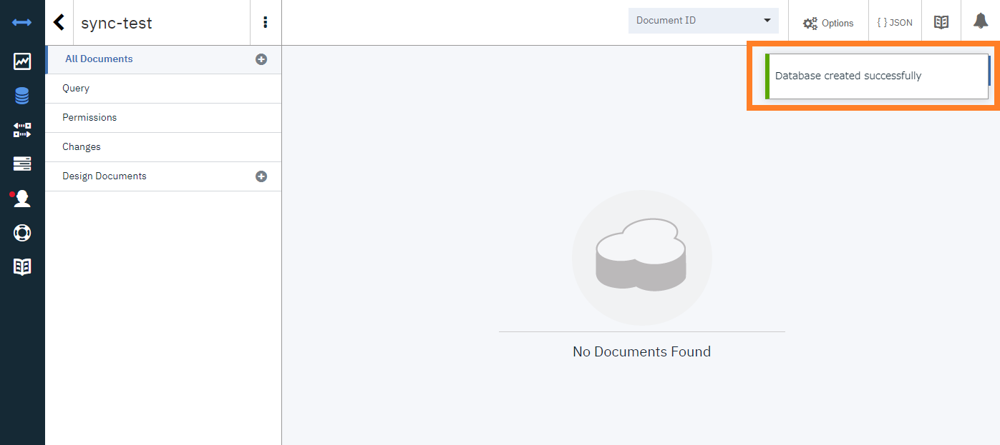

### 認証情報のセットアップ

1. IBM Cloud に戻って、「サービス資格情報」をクリックしてください。おそらく何も表示されていないので、「新規資格情報」をクリックします。  
    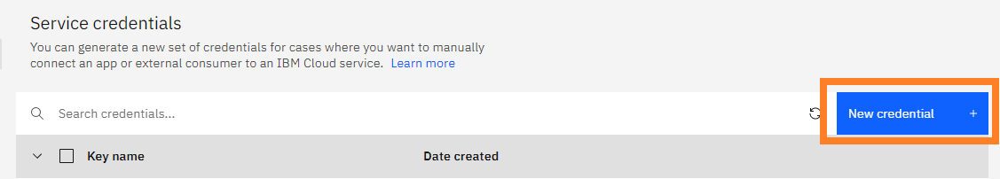

1.  認証情報を作成するダイアログが表示されるので、任意の名前を入力するか既定のままにして、「追加」ボタンをクリックしてください。  
    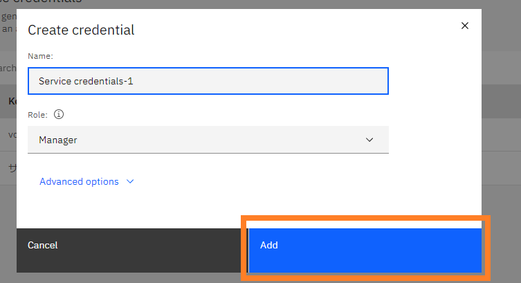  
    備考: この「名前」は Self-hosted LiveSync で使用する Username とはまた別のものです。

1. 「サービス資格情報」に戻ると、新しい認証情報が作成されています。~~わかりにくいことに名前は「鍵名」に変わります~~。左側のボタンを押すと詳細が開きます。  
    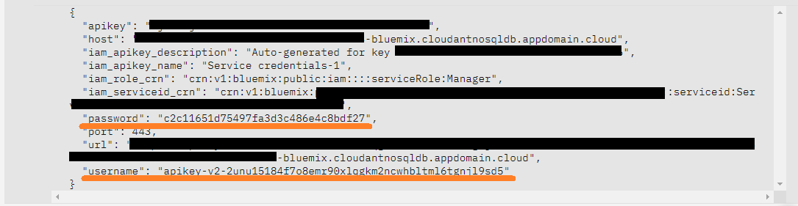  
    Self-hosted LiveSync から使用する Username と Password は、表示された JSON に記載されているものを使用します。  
	今回の図で言うと、Username は"apikey-v2-2unu15184f7o8emr90xlqgkm2ncwhbltml6tgnjl9sd5"(\*3)、パスワードは"c2c11651d75497fa3d3c486e4c8bdf27"(\*4)になります。

## Self-hosted LiveSync に設定

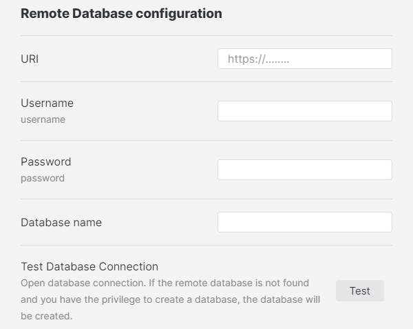

先ほどの設定例から引用すると、

| 項目 | 値 | 例 |
| --- | --- | --- |
| URI | (\*1) | https://xxxxxxxxxxxxxxxxx-bluemix.cloudantnosqldb.appdomain.cloud |
| Username | (\*3) | apikey-v2-2unu15184f7o8emr90xlqgkm2ncwhbltml6tgnjl9sd5 |
| Password | (\*4) | c2c11651d75497fa3d3c486e4c8bdf27 |
| Database name | (\*2) | sync-test |

のとおりです。
