# Set up Object Storage

This guide establishes Object Storage synchronisation on a first device, generates a Setup URI for another device from that working device, and verifies synchronisation in both directions.

Object Storage exchanges compressed [journals](glossary.md#user-facing-and-operational-terms) through an S3-compatible service or server (such as Cloudflare R2, Amazon S3, or MinIO). It supports manual, periodic, and event-triggered synchronisation; real-time LiveSync mode is unavailable. A CouchDB server is not required.

Before selecting a commercial storage service or configuring polling intervals, see [Object Storage transfers, request scaling, and service costs](setup_object_storage_costs.md).

## Before starting

Prepare the following:

- an HTTPS endpoint reachable by every device;
- an access key and secret key with access to the selected bucket;
- a bucket name and region;
- a unique bucket prefix when the bucket is shared or reserved for this Vault;
- CORS configuration permitting Obsidian's web origins (`app://obsidian.md`, `capacitor://localhost`, `http://localhost`) with `ETag` exposed (or enable `Use internal API` during setup to bypass CORS restrictions); and
- separate passphrases for Vault encryption and Setup URI encryption.

Back up every Vault involved, and do not use Obsidian Sync, iCloud synchronisation, or another synchronisation service on the same Vault.

### Setting fields reference

Match your storage service credentials to the plug-in setup fields:

| Value from your service or server | Setup dialogue field | Setup URI generator variable |
| --- | --- | --- |
| S3 API endpoint (not the admin web console) | `Endpoint URL` | `endpoint` |
| Access key ID | `Access Key ID` | `access_key` |
| Secret access key | `Secret Access Key` | `secret_key` |
| Existing bucket name | `Bucket Name` | `bucket` |
| Region specified by the provider (e.g., `auto` for R2) | `Region` | `region` |
| Folder prefix reserved for this Vault, such as `my-vault/` | `Folder Prefix` | `bucket_prefix` |
| Path-style addressing (required by some servers like MinIO) | `Use Path-Style Access` | `force_path_style` |
| Bypass CORS via Obsidian's native request API | `Use internal API` | `use_custom_request_handler` |

## Generate the initial Setup URI

> [!TIP]
> If you prefer to configure settings directly in Obsidian rather than using the command-line Setup URI generator, see [Configure the first device manually](#configure-the-first-device-manually).

The public generator applies the Object Storage preset and records the connection as the selected remote profile. Run it from a trusted terminal:

```sh
export remote_type=s3
export endpoint='https://objects.example.com'
export access_key='<ACCESS KEY>'
export secret_key='<SECRET KEY>'
export bucket=vault-data
export region=auto
export bucket_prefix=my-vault
export LIVESYNC_PASSPHRASE='<A STRONG VAULT ENCRYPTION PASSPHRASE>'
export uri_passphrase='<A SEPARATE SETUP URI PASSPHRASE>'
deno run --minimum-dependency-age=0 --allow-env https://raw.githubusercontent.com/vrtmrz/obsidian-livesync/main/utils/setup/generate_setup_uri.ts
```

For providers which require them, set `force_path_style`, `use_custom_request_handler`, or `bucket_custom_headers` as described in the [setup utility reference](../utils/readme.md#object-storage).

Store the generated Setup URI and Setup URI passphrase separately. The URI is encrypted, but it contains the Object Storage credentials. The generator also prints an ID recovery code; reuse it through `id_recovery_code` if you regenerate a URI for the same Vault. A new run without it creates a different ID key. The [setup utility reference](../utils/readme.md#setup-uri-generation) describes the `id_mode=legacy` option for existing Vaults.
The generator prints the exact end time of its default Ephemeral URI. Set `uri_mode=persistent` before running it if the URI must remain usable without a time condition.

## Set up the first device

Use a new bucket prefix, or a prefix whose contents you deliberately intend to replace.

1. Install and enable Self-hosted LiveSync in the intended Vault.
2. Open onboarding from the `Welcome to Self-hosted LiveSync` Notice.
3. Select `I am setting this up for the first time`, then choose the recommended Setup URI method.
4. Paste the initial Setup URI, enter its passphrase, and select `Test Settings and Continue`.

    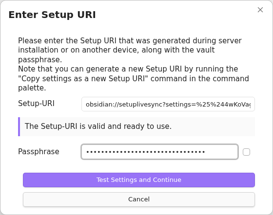

5. Select `Restart and Initialise Server`, then read and accept the final overwrite confirmation only when this Vault is the intended source of truth.

    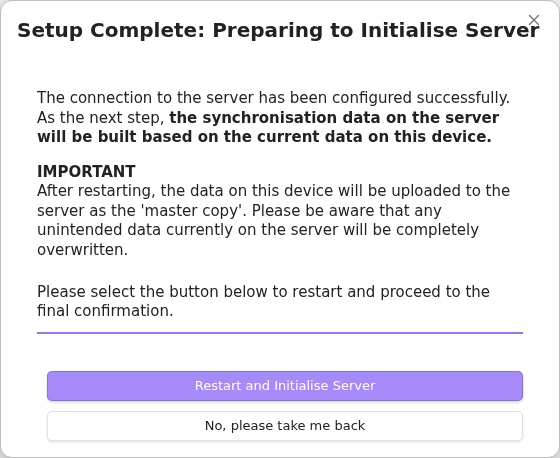

    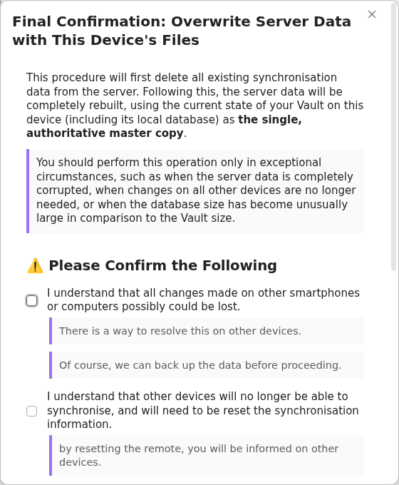

6. A new prefix may show `No Synchronisation Settings Found`. Select `Use this device's settings` for a genuinely new prefix. If you expected existing settings, cancel and check the endpoint, credentials, bucket, and prefix. Cancellation restarts with Vault and database reflection paused; keep LiveSync disabled until the remote has been checked. If `Could Not Read Synchronisation Settings` appears, retry, or use this device's settings to continue the overwrite. The overwrite still requires a working connection.

    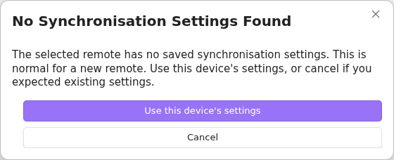

7. Keep optional features disabled until ordinary note synchronisation works.
8. Create an ordinary test note, and keep Obsidian open until the LiveSync progress indicators have cleared.

## Generate the second-device Setup URI

Generate a fresh Setup URI from the working first device:

1. Run `Self-hosted LiveSync: Copy settings as a new Setup URI` from the command palette.
2. Enter a new Setup URI passphrase.

    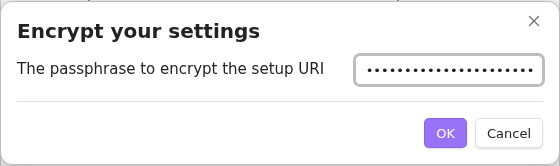

3. Copy the resulting URI.

    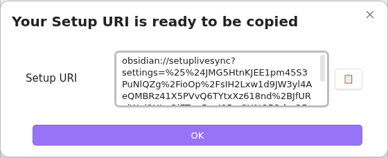

Store this URI and its passphrase separately.

## Add another device

Start with a new or separately backed-up Vault.

1. Install and enable Self-hosted LiveSync.
2. Open onboarding, select `I am adding a device to an existing synchronisation setup`, and choose the recommended Setup URI method.
3. Enter the URI generated by the first device and its passphrase.

    

4. Select `Restart and Fetch Data`.

    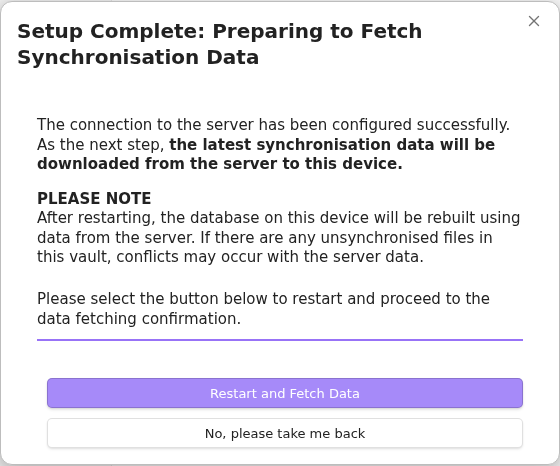

5. For a new or empty Vault, choose `Overwrite all with remote files`, then `Keep local files even if not on remote`. Review the [Fast Setup guide](./tips/fast-setup.md) before choosing a different policy for a Vault containing local work.

    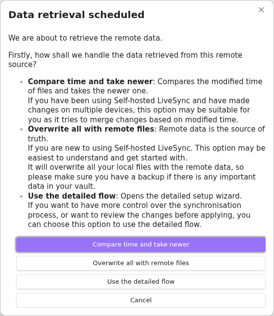

    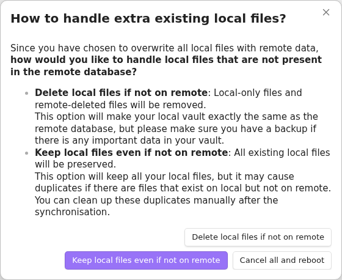

6. Keep Obsidian open until retrieval and file reflection finish.

Confirm that the first device's test note appears unchanged. Create a second ordinary note on the new device, wait for its journal synchronisation to finish, and confirm that it reaches the first device. Configure optional features only after this two-way check passes.

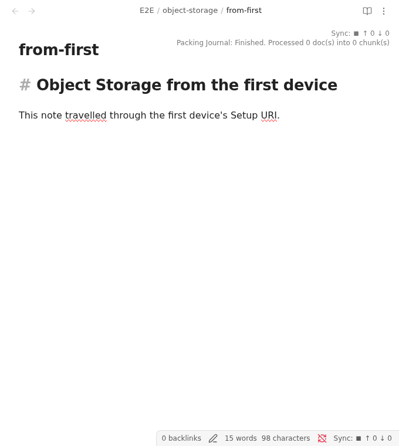

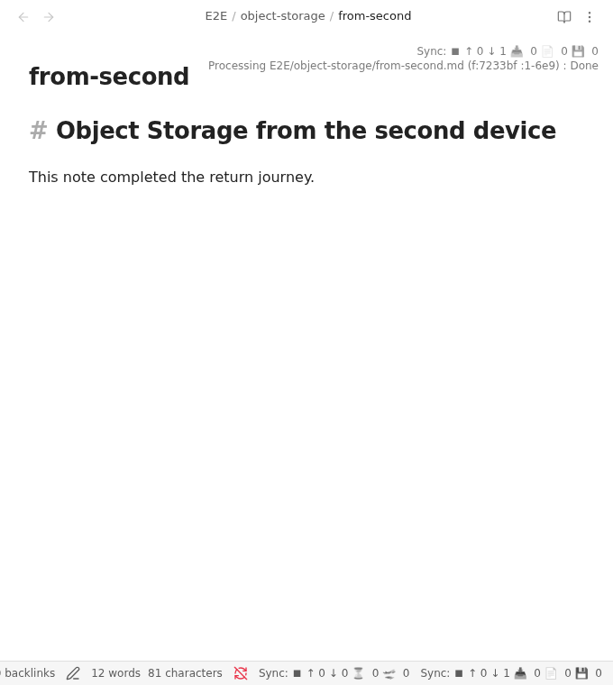

## Configure the first device manually

If you prefer to configure settings directly in Obsidian rather than using the Deno Setup URI generator, use this manual procedure:

1. Install and enable Self-hosted LiveSync, then open onboarding from the `Welcome to Self-hosted LiveSync` Notice.
2. Select `I am setting this up for the first time`, then choose `Configure a remote manually` and select `Proceed with manual configuration`.
3. Configure `End-to-End Encryption` and enter a strong Vault encryption passphrase. Save this passphrase securely.
4. Select the S3-compatible Object Storage option and proceed to `S3/MinIO/R2 Configuration`.
5. Enter your bucket settings using the [Setting fields reference](#setting-fields-reference) table above.
6. Select `Test Settings and Continue`. If the connection test fails, verify the API endpoint, credentials, bucket permissions, and region. If CORS blocks the request or cannot be configured on your bucket, enable `Use internal API` to route requests through Obsidian's native HTTP handler.
7. Proceed to `Restart and Initialise Server`, then complete the confirmation steps as described in [Set up the first device](#set-up-the-first-device).
8. Once your test note synchronises, follow [Generate the second-device Setup URI](#generate-the-second-device-setup-uri) to connect subsequent devices easily.

## Safety notes

- Treat the endpoint, bucket, prefix, access key, secret key, Vault passphrase, Setup URI, and Setup URI passphrase as sensitive.
- Use a distinct prefix per synchronisation set unless shared data is explicitly intended.
- Do not initialise the first device against an existing prefix unless replacing its contents is deliberate.
- Object Storage is not a Vault backup. Keep independent backups and test restoration separately.
