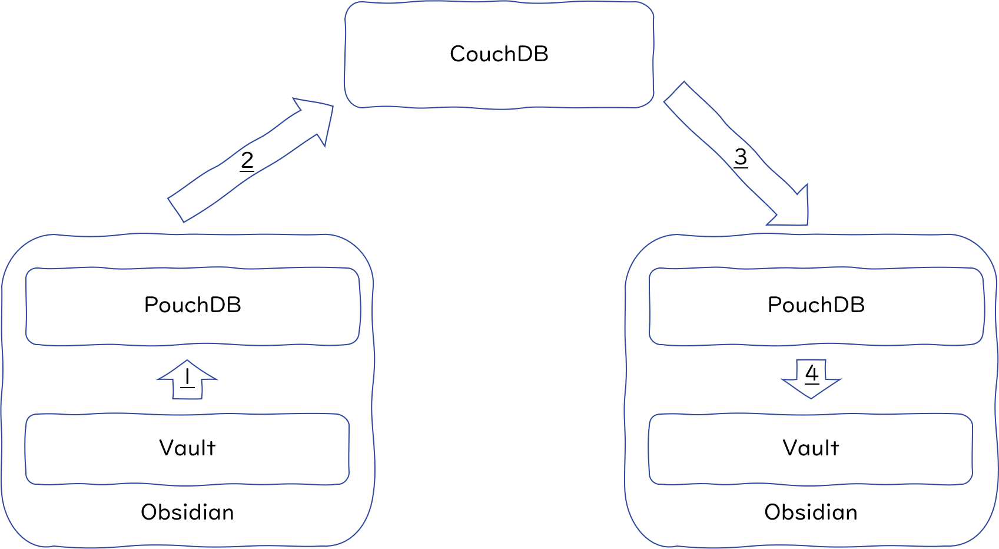
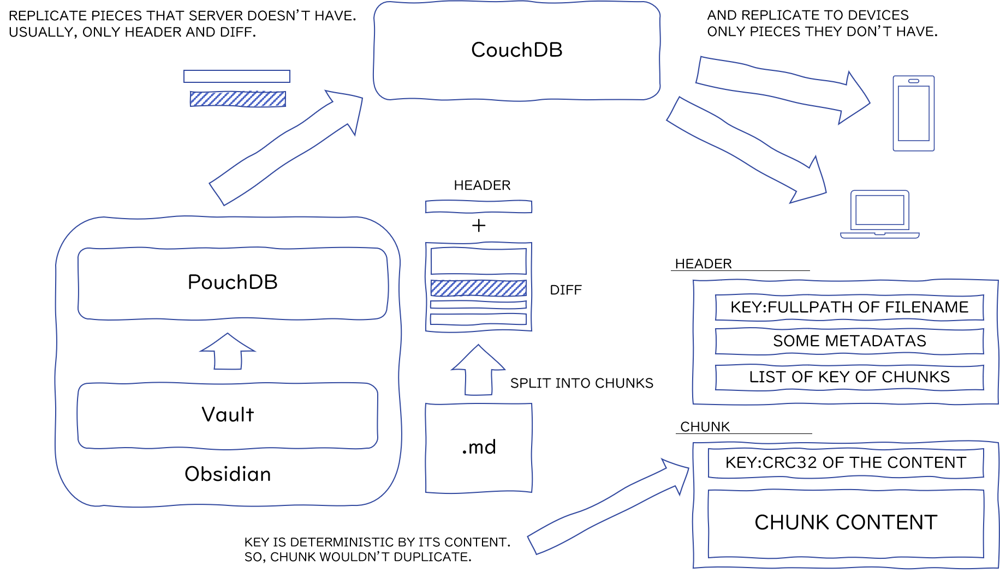

# アーキテクチャ設計

## 同期

1. ノートが更新されると、Obsidian からイベントが通知されます。Self-hosted LiveSync はイベントを処理し、ローカルの PouchDB に変更を反映します。
2. PouchDB は差分をリモートの CouchDB に複製します。
3. 他のデバイスはリモートの CouchDB を監視し、変更を検出すると差分をダウンロードします。
4. Self-hosted LiveSync は、PouchDB が受信した変更を Obsidian の Vault に反映します。

図では2台のデバイス間の一方向として示していますが、実際には複数のデバイス間で双方向に同期します。

## ファイルイベントとストレージ書き込み

ファイルイベントは、Vault 内で検出された変更を表します。Commonlib はこれらのイベントをフィルタリングおよび直列化してから、ローカルデータベース内のファイルメタデータを更新します。したがって、キューに入った `DELETE` はデータベースの変更を要求するものであり、それ自体が物理ファイルを削除する命令ではありません。同期対象外へのファイル名の変更も、宛先ファイルがディスク上に残ったままデータベース上は削除扱いとなる場合があります。

逆方向の処理はデータベースのメタデータから始まります。レプリケーションされた変更やフルスキャンによってデータベースからストレージへのハンドラが呼び出され、競合およびコンテンツ保護ルールに従って Vault ファイルの書き込みや削除が行われます。古いファイルイベントによるメタデータの削除を防ぐことと、正当なレプリケーションによる削除を適用することは、別の判断基準として扱われます。

Commonlib の [Storage events and database-to-storage reflection](https://github.com/vrtmrz/livesync-commonlib/blob/main/docs/storage-events-and-reflection.md) には、イベントの境界、Commonlib 0.1.23 で導入された削除の再検証、およびその制限事項が記載されています。特に、削除保護機能は外部フォルダの大文字小文字の変更やパスの表記揺れの完全な収束を保証するものではありません。

## 現在の技術リファレンス

- [データベースのデータ構造 (Database Data Structures)](datastructure.md): 現在のメタデータおよびチャンクの形式、識別子の取り扱い、削除、リモート上の生の表現について解説しています。
- [Replicator のアーキテクチャ (Replicator architecture)](design_docs/replicator_architecture.md): プロバイダーの構成、アクティブな Replicator の公開、終了、および P2P の所有権について解説しています。
- [競合解決とリビジョン履歴 (Conflict resolution and revision provenance)](specs_conflict_resolution.md): 現在のリビジョンツリーおよびファイルの来歴ルールを定義しています。
- [チャンクの取得と待機 (Chunk Retrieval and Waiting)](design_docs/chunk_retrieval_and_waiting.md): 不足しているチャンクの到着と、処理が落ち着くまでの待機の扱いを定義しています。
- [パスコンポーネント長の互換性 (Path component length compatibility)](design_docs/path_component_length_compatibility.md): 255 UTF-8 バイトがパスの妥当性を判断する普遍的な規則ではなく、Android や Linux における互換性警告である理由を解説しています。
- [データ圧縮 (Data Compression)](specs_data_compression.md) および [ガベージコレクション V3 (Garbage Collection V3)](specs_garbage_collection.md): それぞれのストレージとメンテナンスに関する取り決めを説明しています。

## 帯域幅低減のために

